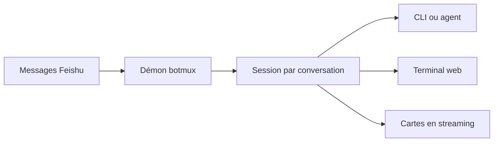

# deepcoldy/botmux

> A daemon that connects Feishu or Lark to your CLI coding agents, with live cards and a web terminal.

## The problem
The agent runs on the dev machine and you are on your phone: no notification, no way to drive it or talk to it from the team messenger.

## What it actually does
The daemon listens to Feishu messages, starts one session per conversation and sends the agent's output back as cards that refresh. More than 20 adapters (claude-code, codex, cursor, opencode, kimi, doubao and others) are plugged in without reimplementing their capabilities. It offers a web terminal, scheduled tasks and several bots in the same group.

## How it is wired
Simplified diagram based on the card, no diagram provided.



## Trying it
```bash
curl -fsSL https://raw.githubusercontent.com/deepcoldy/botmux/master/install.sh | sh
botmux setup
botmux start
npm install -g botmux
```

## Cost and gotchas
Free (MIT), but you need to create a Feishu or Lark app and have the CLI agent already installed and logged in. Windows support goes through WSL2. The README is in Chinese.

## What it is not
Not an agent: it only relays to existing tools. Doubao support has not been validated in real use on Linux, according to the README.

## Alternatives
No alternative named in the README.

## For you
Ignore unless your team works on Feishu or Lark: the whole project is built around that messenger.
