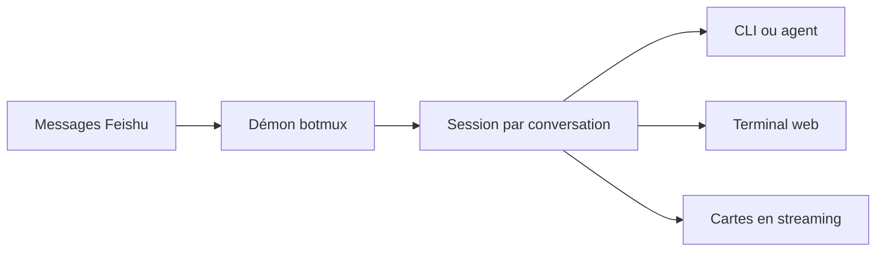

# deepcoldy/botmux

> Un démon qui relie Feishu ou Lark à tes agents de code CLI, avec cartes en direct et terminal web.

## Le problème
L'agent tourne sur la machine de dev et tu es sur ton téléphone : pas de notification, pas de moyen de le piloter ni de lui parler depuis la messagerie d'équipe.

## Ce que ça fait vraiment
Le démon écoute les messages Feishu, lance une session par conversation et renvoie la sortie de l'agent en cartes qui se rafraîchissent. Plus de 20 adaptateurs (claude-code, codex, cursor, opencode, kimi, doubao et d'autres) sont branchés sans réimplémenter leurs capacités. Il offre un terminal web, des tâches planifiées et plusieurs bots dans un même groupe.

## Comment c'est branché
Schéma simplifié d'après la fiche, sans diagramme fourni.



## Essayer
```bash
curl -fsSL https://raw.githubusercontent.com/deepcoldy/botmux/master/install.sh | sh
botmux setup
botmux start
npm install -g botmux
```

## Coût et pièges
Gratuit (MIT), mais il faut une application Feishu ou Lark à créer et l'agent CLI déjà installé et connecté. Le support Windows passe par WSL2. Le README est en chinois.

## Ce que ce n'est pas
Pas un agent : il ne fait que relayer vers des outils existants. Le support de Doubao n'a pas été validé en usage réel sur Linux, selon le README.

## Alternatives
Aucune alternative nommée dans le README.

## Pour toi
À ignorer sauf si ton équipe travaille sur Feishu ou Lark : tout le projet est bâti autour de cette messagerie.

