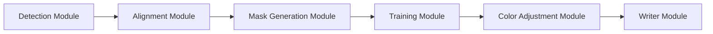

# deepfakes/faceswap

> Python deep-learning face-swapping software, for experimentation and consented visual effects.

## The problem
Face-swapping techniques remained reserved for specialists, for lack of assembled, usable code.

## What it actually does
Three steps: extract faces from photos or videos, train a model on two sets of faces, then convert the sources with that model. Command-line and graphical interfaces. Several model architectures, detectors, aligners and masks are provided as plugins.

## How it is wired


## Trying it
```bash
python faceswap.py extract
python faceswap.py train
python faceswap.py convert
python faceswap.py gui
```

## Cost and gotchas
Free. A recent CUDA GPU is recommended (AMD via ROCm on Linux). Training takes time and data.

## What it is not
It is not a tool to use without the consent of the people involved: the README's manifesto excludes inappropriate content and face-swapping without consent or while hiding its use. Image rights and local law apply to the user.

## Alternatives
The README names no alternative.

## For you
Worth watching: useful for learning to train generative networks on images, provided you use only consented faces and check the GPL-3.0 license before reuse.
