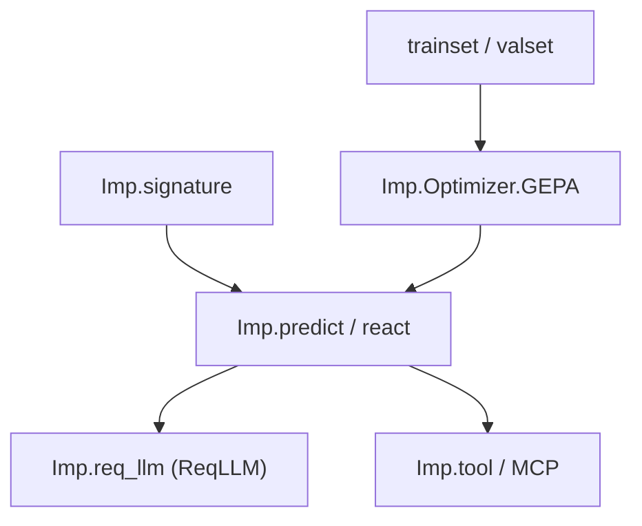

# deepfates/imp

> Port of DSPy for Elixir: declarative LLM programs, optimizable and run as OTP processes.

## The problem
Writing prompts by hand and fixing them by guesswork is fragile; they need to be measured and improved on examples.

## What it actually does
- Typed signatures (`"issue -> kind: enum[bug,feature,question], summary"`): Imp builds the prompt and validates the response.
- Optimizers: GEPA, MIPROv2, SIMBA, BootstrapFewShot, as well as fine-tuning and GRPO; the result is saved as JSON.
- `react` agents with Elixir tools, MCP, ACP for Zed, per-call authorization.
- An agent is a supervised process, with a deadline on requests.

## How it is wired
Simplified diagram based on the sheet, no diagram provided.


## Trying it
```elixir
{:imp, "~> 0.18.0"}

lm = Imp.req_llm("openai:gpt-5.4-mini", api_key: System.fetch_env!("OPENAI_API_KEY"))
triage = "issue -> kind: enum[bug,feature,question], summary" |> Imp.signature("Triage a GitHub issue.") |> Imp.predict(lm: lm)
Imp.call(triage, %{issue: "App crashes on startup"})
```

## Cost and gotchas
Provider API key at your expense; GEPA additionally requires a more capable model, and up to 300 metric calls in the example. Elixir 1.19 or later, C and C++ compilers, network access on first compilation.

## What it is not
Not DSPy itself: a port for Elixir. The README contradicts itself on the version ("Imp 0.14 is experimental", installation at 0.18) and states that the optimizers lack large-scale benchmarks.

## Alternatives
- DSPy: the original in Python, of which Imp is the port.

## For you
Worth watching if you work in Elixir or want to see DSPy on the BEAM; in Python, use DSPy directly, which is more mature.
