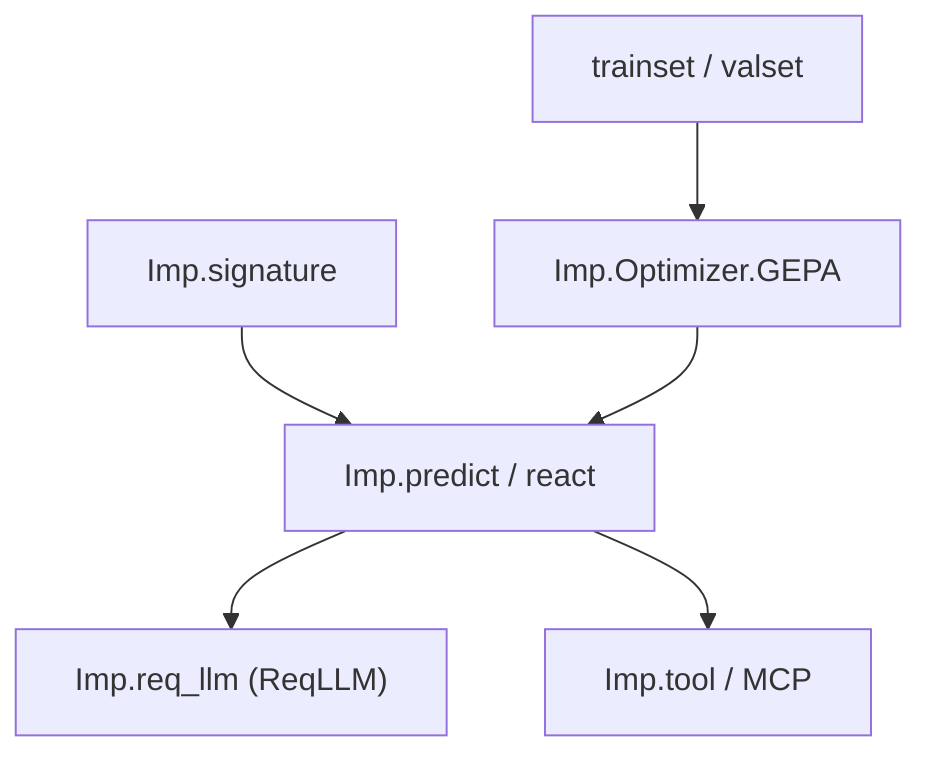

# deepfates/imp

> Port de DSPy pour Elixir : programmes LLM déclaratifs, optimisables et exécutés comme processus OTP.

## Le problème
Écrire des invites à la main et les corriger au jugé est fragile ; il faut les mesurer et les améliorer sur des exemples.

## Ce que ça fait vraiment
- Signatures typées (`"issue -> kind: enum[bug,feature,question], summary"`) : Imp construit l'invite et valide la réponse.
- Optimiseurs : GEPA, MIPROv2, SIMBA, BootstrapFewShot, ainsi qu'un réglage fin et GRPO ; le résultat se sauvegarde en JSON.
- Agents `react` avec outils Elixir, MCP, ACP pour Zed, autorisation par appel.
- Un agent est un processus supervisé, avec échéance sur les requêtes.

## Comment c'est branché
Schéma simplifié d'après la fiche, sans diagramme fourni.


## Essayer
```elixir
{:imp, "~> 0.18.0"}

lm = Imp.req_llm("openai:gpt-5.4-mini", api_key: System.fetch_env!("OPENAI_API_KEY"))
triage = "issue -> kind: enum[bug,feature,question], summary" |> Imp.signature("Triage a GitHub issue.") |> Imp.predict(lm: lm)
Imp.call(triage, %{issue: "App crashes on startup"})
```

## Coût et pièges
Clé API du fournisseur à ta charge ; GEPA demande en plus un modèle plus capable, et jusqu'à 300 appels de métrique dans l'exemple. Elixir 1.19 ou plus, compilateurs C et C++, accès réseau à la première compilation.

## Ce que ce n'est pas
Pas DSPy lui-même : un port pour Elixir. Le README se contredit sur la version (« Imp 0.14 est expérimental », installation en 0.18) et annonce que les optimiseurs manquent de benchmarks à grande échelle.

## Alternatives
- DSPy : l'original en Python, dont Imp est le port.

## Pour toi
À surveiller si tu fais de l'Elixir ou veux voir DSPy sur la BEAM ; en Python, utilise DSPy directement, plus mûr.

