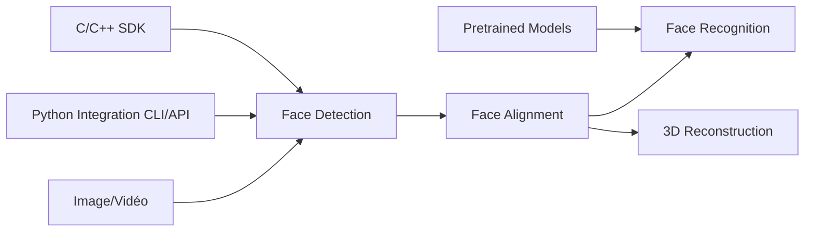

# deepinsight/insightface

> 2D/3D face analysis toolbox (detection, alignment, recognition) for researchers and vision integrators.

## The problem
Building a complete face pipeline (find, align, identify) means gathering scattered models, datasets, losses and evaluation scripts.

## What it actually does
Implements ArcFace, PartialFC, SubCenter ArcFace (recognition), RetinaFace and SCRFD (detection), SDUNets (alignment).
Provides a Python package, a C/C++ SDK (InspireFace), a model zoo and IJB/Megaface evaluation pipelines.
v2.0 adds PrivateFrame (local video blurring), optional liveness detection and InsightFace Server (Web UI, REST API, SQLite, ONNX Runtime).
Maintained mainly by two people (Jia Guo, Jiankang Deng).

## How it is wired

## Trying it
No command documented in the README (points to the python-package and the website).

## Cost and gotchas
GPU needed for training; MXNet 1.6-1.8 and PyTorch 1.6+ coexist. No license declared at repo level: commercial use of the models needs to be clarified.

## What it is not
Not a single ready-to-use API: it is a set of heterogeneous subprojects. Face recognition raises legal constraints (GDPR) that are not addressed here.

## Alternatives
- InsightFace_Pytorch: pure PyTorch reimplementation of ArcFace.
- InsightFace-REST: TensorRT deployment as a REST service.
- wang-xinyu/tensorrtx: optimized TensorRT inference.

## For you
Worth watching: an essential technical reference in face recognition, but the lack of a declared license blocks any product use until it is verified.
