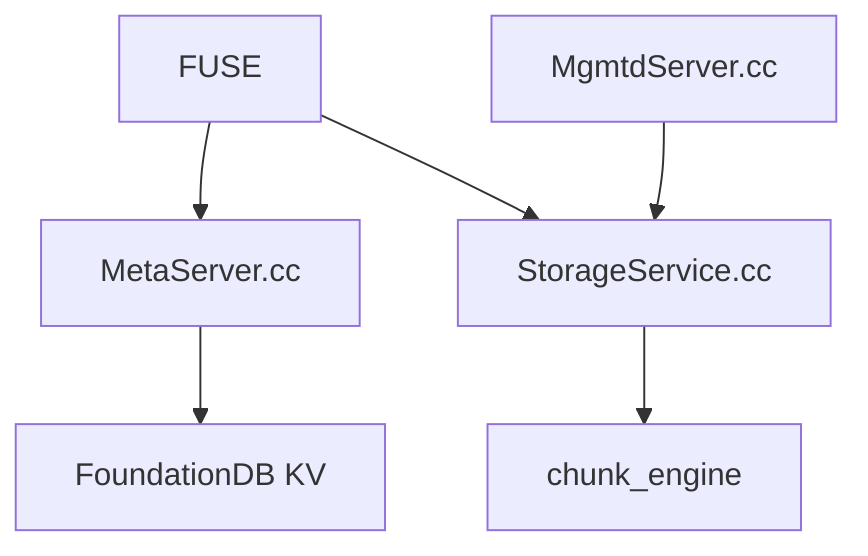

# deepseek-ai/3FS

> Distributed file system on SSD and RDMA for AI training and inference workloads.

## The problem
Large training jobs need shared storage with very high throughput, with random access to samples and checkpoints.

## What it actually does
Disaggregated architecture: stateless metadata on FoundationDB, a management daemon (mgmtd), storage nodes with chain replication (CRAQ) for strong consistency. FUSE interface and USRBIO API. Cited uses: data preparation, dataloaders, checkpoints, KVCache for inference.

## How it is wired


## Trying it
```bash
git clone https://github.com/deepseek-ai/3fs
cd 3fs
git submodule update --init --recursive
./patches/apply.sh
cmake -S . -B build -DCMAKE_CXX_COMPILER=clang++-14 -DCMAKE_C_COMPILER=clang-14 -DCMAKE_BUILD_TYPE=RelWithDebInfo -DSHUFFLE_METHOD=g++11
cmake --build build -j 32
```

## Cost and gotchas
Requires FoundationDB 7.1+, libfuse 3.16.1+, Rust, a specific compiler and RDMA/InfiniBand networks. The `SHUFFLE_METHOD` choice must be kept identical across the whole cluster.

## What it is not
Not an object store nor a workstation tool. The announced throughputs come from a 180-node cluster.

## Alternatives
No alternative named in the README.

## For you
Worth watching: useful to read if you operate a large GPU cluster, otherwise out of reach without RDMA hardware.
