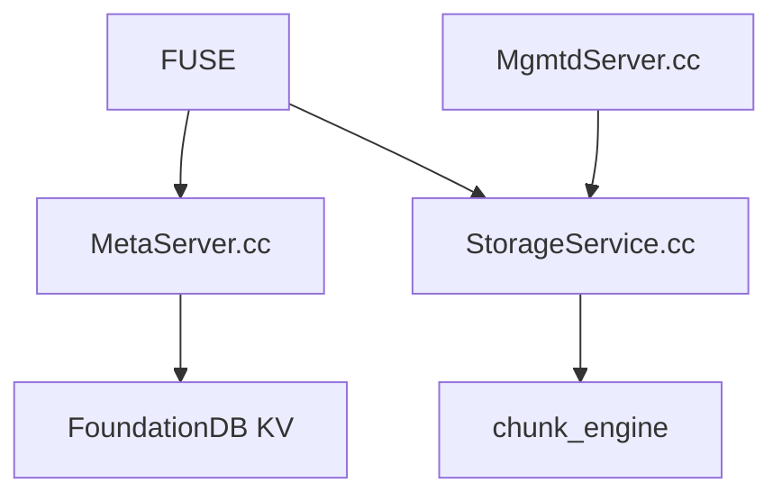

# deepseek-ai/3FS

> Système de fichiers distribué sur SSD et RDMA pour les charges d'entraînement et d'inférence IA.

## Le problème
Les gros jobs d'entraînement ont besoin d'un stockage partagé à très haut débit, avec accès aléatoire aux échantillons et checkpoints.

## Ce que ça fait vraiment
Architecture désagrégée : métadonnées sans état sur FoundationDB, daemon de gestion (mgmtd), nœuds de stockage avec réplication en chaîne (CRAQ) pour la cohérence forte. Interface FUSE et API USRBIO. Usages cités : préparation de données, dataloaders, checkpoints, KVCache pour l'inférence.

## Comment c'est branché


## Essayer
```bash
git clone https://github.com/deepseek-ai/3fs
cd 3fs
git submodule update --init --recursive
./patches/apply.sh
cmake -S . -B build -DCMAKE_CXX_COMPILER=clang++-14 -DCMAKE_C_COMPILER=clang-14 -DCMAKE_BUILD_TYPE=RelWithDebInfo -DSHUFFLE_METHOD=g++11
cmake --build build -j 32
```

## Coût et pièges
Demande FoundationDB 7.1+, libfuse 3.16.1+, Rust, un compilateur précis et des réseaux RDMA/InfiniBand. Le choix de `SHUFFLE_METHOD` est à garder identique dans tout le cluster.

## Ce que ce n'est pas
Pas un stockage d'objets ni un outil de poste de travail. Les débits annoncés viennent d'un cluster de 180 nœuds.

## Alternatives
Aucune alternative nommée dans le README.

## Pour toi
À surveiller : utile à lire si tu opères un gros cluster GPU, sinon hors de portée sans matériel RDMA.

