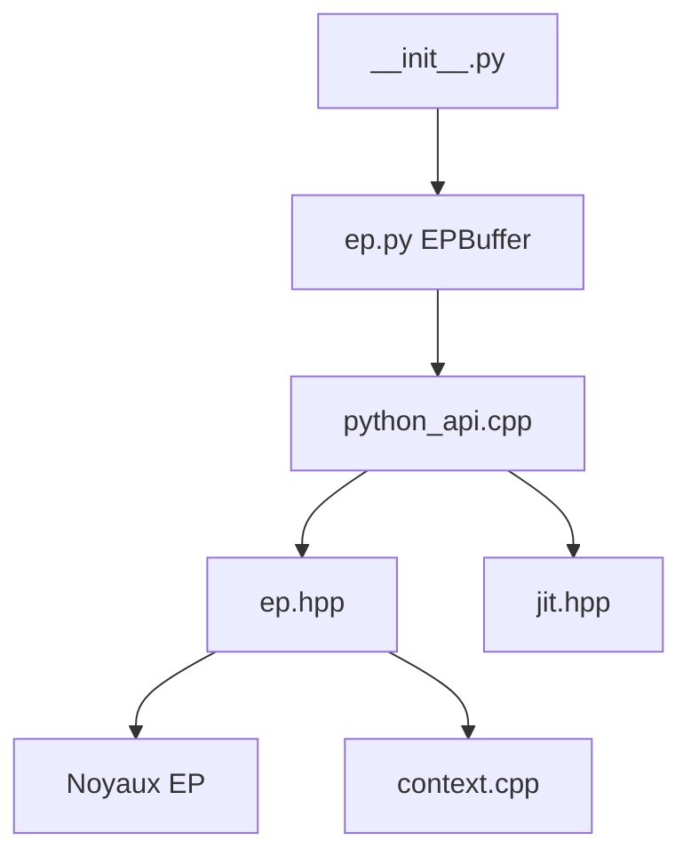

# deepseek-ai/DeepEP

> GPU communication library for expert parallelism in MoE models, for training and inference.

## The problem
In an MoE, routing tokens to experts across many GPUs is a communication bottleneck.

## What it actually does
Provides "dispatch" and "combine" kernels (with FP8) through an `EPBuffer` interface, plus weight and gradient exchange for redundant experts. Experimental primitives: pipeline parallelism, bucketed collectives (all-gather, reduce-scatter, all-reduce) and Engram. The kernels are compiled at runtime by DeepJIT.

## How it is wired


## Trying it
```bash
python -m pip install "nvidia-nccl-cu13>=2.32.3" --no-deps
git submodule update --init --recursive
bash install.sh
bash develop.sh
python tests/ep/test_ep.py
```

## Cost and gotchas
Hopper or newer GPU, CUDA 13.1+, PyTorch 2.10+, NCCL 2.32.3+, NVLink and an RDMA network. Keep the CUDA toolchain available at runtime for JIT compilation.

## What it is not
Not a general-purpose communication library: it is MoE-oriented. The Bucket, Engram and PP features are experimental. The README provided is truncated at the end of the document.

## Alternatives
No alternative named in the README (it cites NCCL as its base).

## For you
Worth watching: only if you train or serve MoEs on a GPU cluster with RDMA, otherwise irrelevant.
