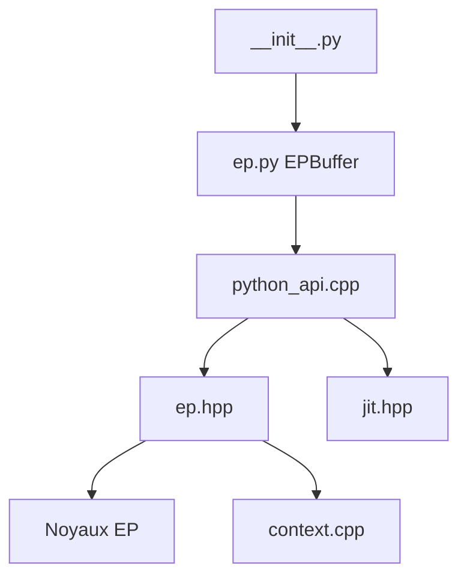

# deepseek-ai/DeepEP

> Bibliothèque de communication GPU pour le parallélisme d'experts des modèles MoE, à l'entraînement et à l'inférence.

## Le problème
Dans un MoE, répartir les jetons vers les experts sur de nombreux GPU est un goulot d'étranglement de communication.

## Ce que ça fait vraiment
Fournit les noyaux « dispatch » et « combine » (avec FP8) via une interface `EPBuffer`, plus l'échange de poids et de gradients pour experts redondants. Primitives expérimentales : parallélisme de pipeline, collectives en seaux (all-gather, reduce-scatter, all-reduce) et Engram. Les noyaux sont compilés à l'exécution par DeepJIT.

## Comment c'est branché


## Essayer
```bash
python -m pip install "nvidia-nccl-cu13>=2.32.3" --no-deps
git submodule update --init --recursive
bash install.sh
bash develop.sh
python tests/ep/test_ep.py
```

## Coût et pièges
GPU Hopper ou plus récent, CUDA 13.1+, PyTorch 2.10+, NCCL 2.32.3+, NVLink et réseau RDMA. Garder la chaîne CUDA disponible à l'exécution pour la compilation JIT.

## Ce que ce n'est pas
Pas une bibliothèque générale de communication : orientée MoE. Les fonctions Bucket, Engram et PP sont expérimentales. Le README fourni est tronqué en fin de document.

## Alternatives
Aucune alternative nommée dans le README (il cite NCCL comme base).

## Pour toi
À surveiller : seulement si tu entraînes ou sers des MoE sur grappe GPU avec RDMA, sinon sans objet.

