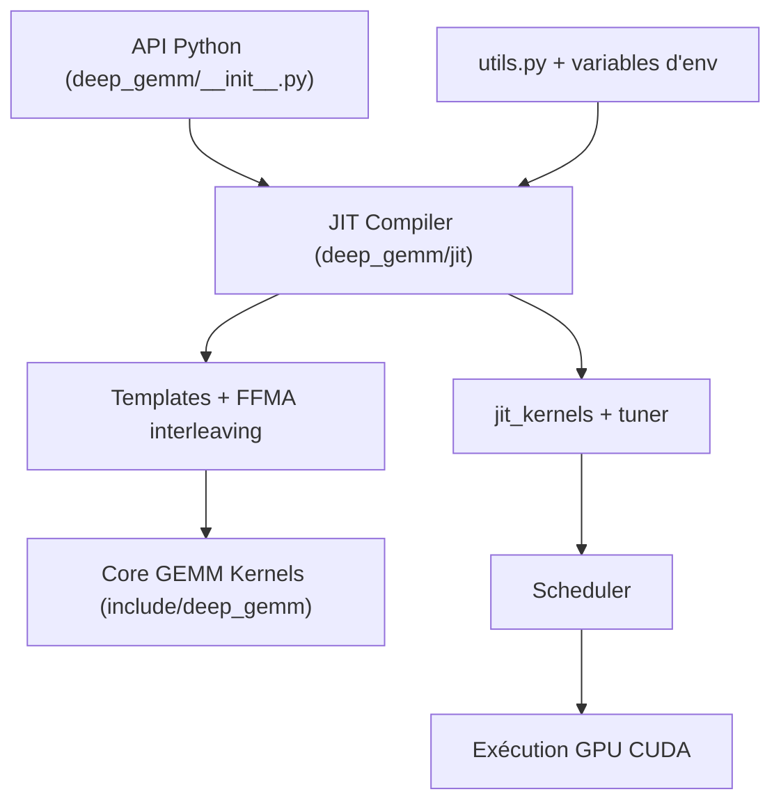

# deepseek-ai/DeepGEMM

> Library of CUDA kernels (FP8/FP4/BF16 GEMM, fused MoE) for inference engineers on recent NVIDIA GPUs.

## The problem
Matrix multiplications in LLMs (dense, grouped MoE, MQA indexer) are slow if the kernels are not tuned per matrix shape.

## What it actually does
Exposes Python functions (`fp8_gemm_nt`, contiguous or masked grouped GEMMs, `fp8_fp4_mqa_logits`, Mega MoE) whose CUDA kernels are compiled at runtime by a JIT, with no CUDA compilation at install time. Targets SM90 and SM100 GPUs. Tuning is done through `DG_JIT_*` variables and utility functions. Transpositions and FP8 conversions are left to the user.

## How it is wired


## Trying it
```bash
git clone --recursive git@github.com:deepseek-ai/DeepGEMM.git
cd DeepGEMM
cat develop.sh
./develop.sh
# ou installation
cat install.sh
./install.sh
```

## Cost and gotchas
Requires an NVIDIA SM90 or SM100 GPU, CUDA Toolkit 12.9+, PyTorch 2.3+ (2.9+ for Mega MoE), a C++20 compiler, and the CUTLASS submodule. No bill, but high-end hardware.

## What it is not
Not an inference framework: only kernels. Does not run on older GPUs or on CPU. The kernels do not include FP8 casting or transposition.

## Alternatives
- CUTLASS: the README draws inspiration from it without depending on it; more generic, heavier on templates.

## For you
Keep an eye on it: useful if you are optimizing an MoE inference stack on Hopper/Blackwell, of no interest without that hardware.
