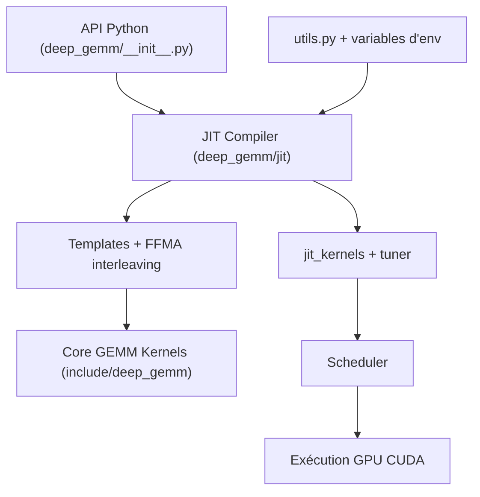

# deepseek-ai/DeepGEMM

> Bibliothèque de noyaux CUDA (GEMM FP8/FP4/BF16, MoE fusionné) pour ingénieurs d'inférence sur GPU NVIDIA récents.

## Le problème
Les multiplications de matrices des LLM (dense, MoE groupé, indexeur MQA) sont lentes si les noyaux ne sont pas réglés par forme de matrice.

## Ce que ça fait vraiment
Expose des fonctions Python (`fp8_gemm_nt`, GEMM groupés contigus ou masqués, `fp8_fp4_mqa_logits`, Mega MoE) dont les noyaux CUDA sont compilés à l'exécution par un JIT, sans compilation CUDA à l'installation. Cible les GPU SM90 et SM100. Réglages par variables `DG_JIT_*` et fonctions utilitaires. Les transpositions et conversions FP8 restent à la charge de l'utilisateur.

## Comment c'est branché


## Essayer
```bash
git clone --recursive git@github.com:deepseek-ai/DeepGEMM.git
cd DeepGEMM
cat develop.sh
./develop.sh
# ou installation
cat install.sh
./install.sh
```

## Coût et pièges
Exige un GPU NVIDIA SM90 ou SM100, CUDA Toolkit 12.9+, PyTorch 2.3+ (2.9+ pour Mega MoE), compilateur C++20, sous-module CUTLASS. Pas de facture, mais du matériel haut de gamme.

## Ce que ce n'est pas
Pas un framework d'inférence : seulement des noyaux. Ne tourne pas sur GPU plus anciens ni sur CPU. Les noyaux n'incluent pas le casting FP8 ni la transposition.

## Alternatives
- CUTLASS : le README s'en inspire sans en dépendre ; plus générique, plus lourd en templates.

## Pour toi
Surveiller : utile si tu optimises une pile d'inférence MoE sur Hopper/Blackwell, sans intérêt sans ce matériel.

