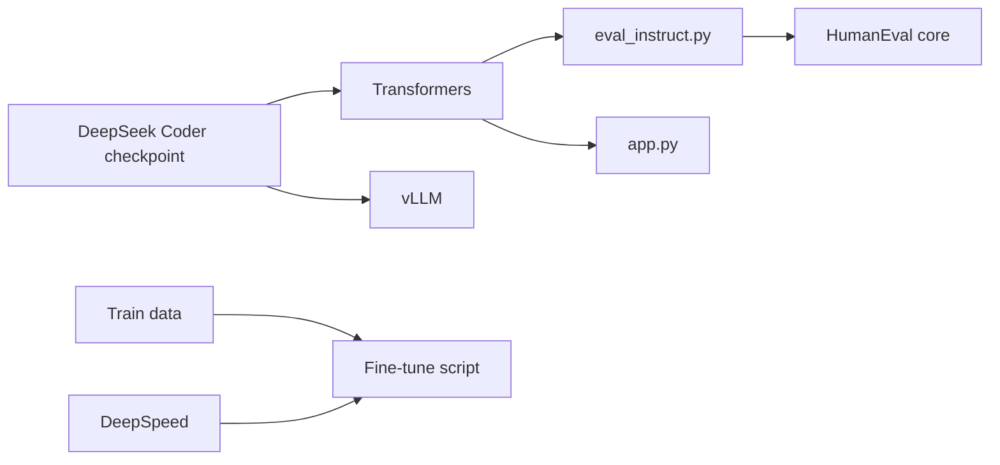

# deepseek-ai/DeepSeek-Coder

> Evaluation, fine-tuning and demo tooling around the DeepSeek Coder code models (1B to 33B).

## The problem
Evaluating and adapting an open code LLM on your own tasks requires reliable benchmark harnesses and fine-tuning scripts.

## What it actually does
Models trained on 2T tokens (87% code), 16K window, fill-in-the-middle task for repository-level completion.
`Evaluation/`: HumanEval, MBPP, LeetCode, DS-1000, PAL-Math, with execution of the generated solutions.
`finetune/finetune_deepseekcoder.py`: DeepSpeed ZeRO-3 fine-tuning on `instruction`/`output` data.
Transformers and vLLM inference examples; local demo `demo/app.py`.

## How it is wired


## Trying it
```bash
pip install -r requirements.txt
pip install -r finetune/requirements.txt
```

## Cost and gotchas
Free; GPU required (bf16, `.cuda()`). `trust_remote_code=True` in all the examples. Model license distinct from the code license.

## What it is not
Not the pre-training code. 2023 models, surpassed by later generations.

## Alternatives
- awesome-deepseek-coder: list of related projects, not a replacement.

## For you
Keep an eye on it: the evaluation harness and the fine-tuning script remain reusable, but the models themselves have aged.
