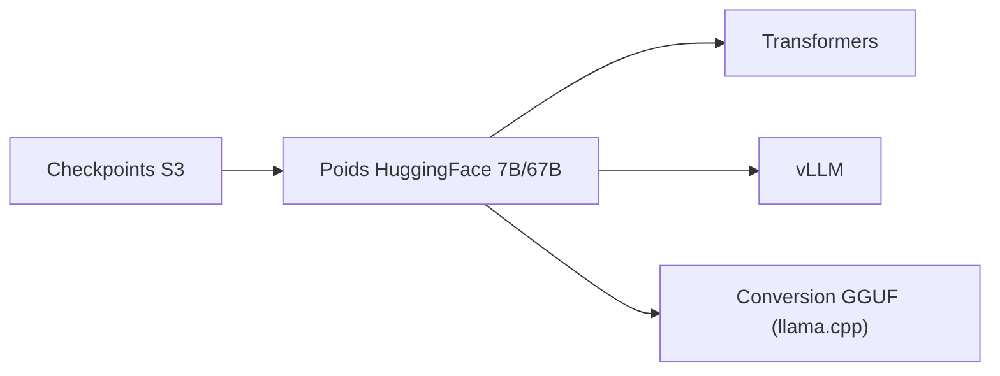

# deepseek-ai/DeepSeek-LLM

> Open DeepSeek language models, 7B and 67B (base and chat), bilingual English-Chinese, trained on 2 trillion tokens.

## The problem
Having open models that are competitive in reasoning, code, maths and Chinese, usable in research and commercially.

## What it actually does
Publishes the 7B and 67B weights (base and chat) on Hugging Face, with the same architecture as LLaMA (MHA for 7B, GQA for 67B), 4096 context. The README gives evaluation results (HumanEval 73.78 for the 67B Chat, GSM8K 84.1), Transformers and vLLM inference examples, intermediate checkpoints on S3 and GPU consumption. The evaluations come from an internal framework that is not open.

## How it is wired


## Trying it
```bash
pip install -r requirements.txt
# Inférence : AutoModelForCausalLM.from_pretrained("deepseek-ai/deepseek-llm-67b-chat", ...)
aws s3 cp s3://deepseek-ai/DeepSeek-LLM/DeepSeek-LLM-7B-Base <local_path> --recursive --request-payer
```

## Cost and gotchas
The 67B requires 8 A100 40 GB GPUs in the README's measurements. The S3 checkpoints are `--request-payer`: the transfer is at your expense. Do not use a system prompt.

## What it is not
Not a recent model: last push in February 2024. The scores are the author's own, outside an open framework, and the README admits discrepancies with the converted weights.

## Alternatives
- LLaMA-2: comparison model cited in the tables.

## For you
Ignore: a late-2023 model, frozen since February 2024; keep it as a historical reference point, not as a building block to deploy.
