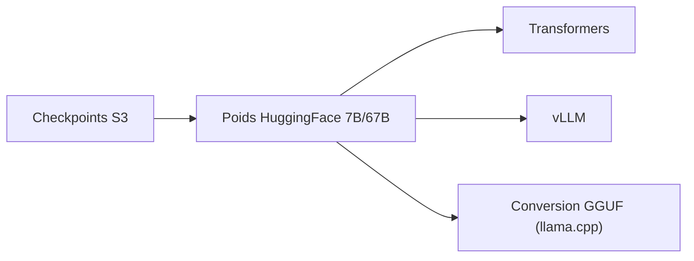

# deepseek-ai/DeepSeek-LLM

> Modèles de langage ouverts DeepSeek 7B et 67B (base et chat), bilingues anglais-chinois, entraînés sur 2 000 milliards de jetons.

## Le problème
Disposer de modèles ouverts compétitifs en raisonnement, code, maths et chinois, utilisables en recherche et en commerce.

## Ce que ça fait vraiment
Publie les poids 7B et 67B (base et chat) sur Hugging Face, avec la même architecture que LLaMA (MHA pour 7B, GQA pour 67B), contexte de 4096. Le README donne des résultats d'évaluation (HumanEval 73,78 pour le 67B Chat, GSM8K 84,1), des exemples d'inférence Transformers et vLLM, des points de contrôle intermédiaires sur S3 et la consommation GPU. Les évaluations viennent d'un cadre interne non ouvert.

## Comment c'est branché


## Essayer
```bash
pip install -r requirements.txt
# Inférence : AutoModelForCausalLM.from_pretrained("deepseek-ai/deepseek-llm-67b-chat", ...)
aws s3 cp s3://deepseek-ai/DeepSeek-LLM/DeepSeek-LLM-7B-Base <local_path> --recursive --request-payer
```

## Coût et pièges
Le 67B demande 8 GPU A100 40 Go dans les mesures du README. Les points de contrôle S3 sont en `--request-payer` : le transfert est à ta charge. Ne pas utiliser de prompt système.

## Ce que ce n'est pas
Pas un modèle récent : dernier push en février 2024. Les scores sont ceux de l'auteur, hors cadre ouvert, et le README admet des écarts avec les poids convertis.

## Alternatives
- LLaMA-2 : modèle de comparaison cité dans les tableaux.

## Pour toi
Ignorer : modèle de fin 2023, figé depuis février 2024 ; garde-le comme point de référence historique, pas comme brique à déployer.

