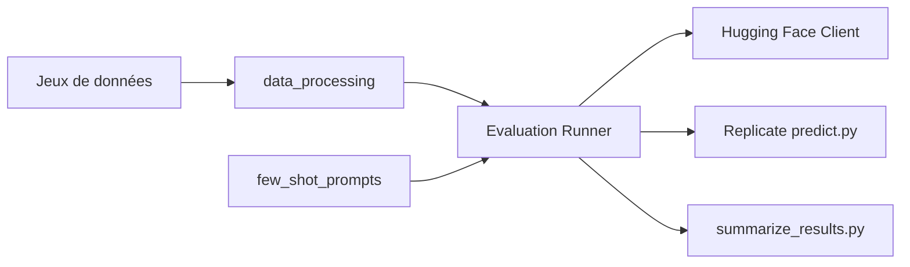

# deepseek-ai/DeepSeek-Math

> 7-billion-parameter models specialized in mathematics, with evaluation code, for research.

## The problem
General-purpose open models reason poorly on competition-level problems, and mathematical data on the web is scattered.

## What it actually does
Three models (Base, Instruct, RL) start from DeepSeek-Coder-v1.5 7B, with 500 billion tokens of pre-training; the RL uses GRPO. The math corpus comes from Common Crawl (35.5 million pages, 120 billion tokens) through iterative selection with fastText. The weights are on Hugging Face; the repository provides inference and evaluation scripts (chain of thought, PAL, integrated tools), all driven by JSON configurations.

## How it is wired


## Trying it
```bash
pip install torch transformers
```
```python
from transformers import AutoTokenizer, AutoModelForCausalLM
model_name = "deepseek-ai/deepseek-math-7b-instruct"
tokenizer = AutoTokenizer.from_pretrained(model_name)
model = AutoModelForCausalLM.from_pretrained(model_name, device_map="auto")
```

## Cost and gotchas
A GPU able to load a 7B in bfloat16. You need the step-by-step reasoning instruction with `\boxed{}`, and should avoid the system prompt. The sequence length is 4096.

## What it is not
Not a maintained repository: last push in April 2024. The README refers to a "License" section that is absent from the supplied text (the numbering skips from 5 to 8): the terms of use of the weights cannot be read there, while the code is under MIT.

## Alternatives
No alternative is cited in the README.

## For you
Ignore for production: frozen since 2024; keep it to read the method (iterative corpus, GRPO) and reproduce the evaluations.
