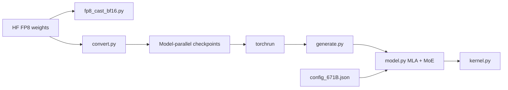

# deepseek-ai/DeepSeek-V3

> Weight and inference code for the DeepSeek-V3 MoE model (671M parameters, 37M active).

## The problem
Studying or setting up a large, open-source model yourself requires having the necessary weights, configuration, and inference code to load and use it.

## What it actually does
The README describes the model: attention mechanism (MLA), DeepSeekMoE routing without auxiliary loss, multi-token prediction objective, FP8 training, 128K context, weights available on Hugging Face (685 GB with the MTP module).

The code consists of a demonstration of inference: `convert.py` splits the FP8 Hugging Face weights into model-parallel shards, `fp8_cast_bf16.py` generates BF16, and `generate.py`, launched by `torchrun`, performs interactive or batch generation. `model.py` contains the graph, and `kernel.py` contains the Triton kernels. There is no service API.

## How it is wired

## Trying it
There is no command in the read-only part of the README: section 6, "How to Run Locally," is truncated.

## Cost and gotchas
Free weights, but with 671 million parameters: multiple GPU nodes, with shards aligned according to the degree of parallelism. The weights follow a separate "Model Agreement" from the MIT license for the code.

## What it is not
Not a serving model: no API or orchestrator. No training code. MTP support is "under development" on the community side.

## Alternatives
None of the models named in the README (Qwen2.5 72B and LLaMA3.1 405B) appear in the benchmark tables.

## For you
Do not attempt to manage this as a deposit: it is too heavy to handle, and has been frozen since August 2025.
