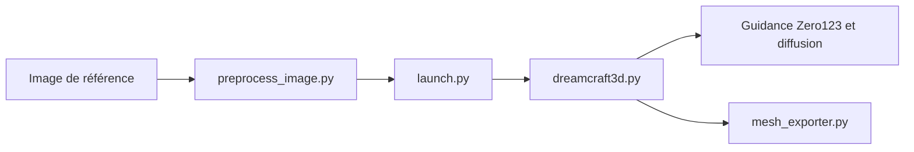

# deepseek-ai/DreamCraft3D

> Official implementation of a paper that generates a textured 3D object from an image and a text prompt.

## The problem
3D generation methods based on score distillation produce geometries that are inconsistent across views, and poor textures.

## What it actually does
Three stages trained one after the other, on threestudio: coarse (NeRF then NeuS), geometry refinement, and texture refinement through "Bootstrapped Score Distillation" with a personalized DreamBooth. Uses Zero123 and Omnidata for depth and normals. Export to an OBJ mesh is possible. A so-called "Janus" problem may require a custom text-to-image model (DeepFloyd + LoRA).

## How it is wired


## Trying it
```bash
python preprocess_image.py /path/to/image.png --recenter
python launch.py --config configs/dreamcraft3d-coarse-nerf.yaml --train system.prompt_processor.prompt="$prompt" data.image_path="$image_path"
python launch.py --config path/to/trial/dir/configs/parsed.yaml --export --gpu 0 resume=path/to/trial/dir/ckpts/last.ckpt system.exporter_type=mesh-exporter
```

## Cost and gotchas
NVIDIA GPU with at least 20 GB of VRAM, CUDA; the default settings run on an A100 40 GB. Separate checkpoints to download. The repository still lists to-do items (test data, results and checkpoints).

## What it is not
Not a ready-to-use service: the pipeline requires several training stages per object. Last push in April 2025.

## Alternatives
The README cites DreamCraft3D++ (a more efficient version), DreamFusion, Magic3D, Magic123, ProlificDreamer as related work.

## For you
Watch: a research reference for 3D, but GPU-expensive and not very active; read the paper rather than installing it.
