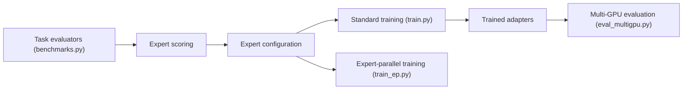

# deepseek-ai/ESFT

> Official code for expert-specialized fine-tuning of Mixture-of-Experts (MoE) language models.

## The problem
Fine-tuning an entire MoE LLM is expensive in compute and storage, even though a given task activates only some of the experts.

## What it actually does
Measures expert activity on task data (intent, law, summarization, translation), computes scores, generates a configuration that selects the relevant experts, then trains only those (`train.py`, or `train_ep.py` for multi-GPU expert parallelism) and evaluates the resulting adapter. The base model is `deepseek-ai/ESFT-vanilla-lite`.

## How it is wired


## Trying it
```bash
pip install transformers torch safetensors accelerate
bash scripts/download_adapters.sh
python scripts/expert/get_expert_scores.py --eval_dataset=intent --base_model_path=deepseek-ai/ESFT-vanilla-lite --output_dir=results/expert_scores/intent --n_sample_tokens=131072 --world_size=4 --gpus_per_rank=2
python train.py --base_model_path=deepseek-ai/ESFT-vanilla-lite --expert_config=results/expert_configs/intent.json --train_dataset=intent --train_config=configs/base.yaml --output_dir=results/checkpoints/intent
```

## Cost and gotchas
Several GPUs (the examples use 4 to 8). The evaluation script requires an OpenAI key (`--openai_api_key`, GPT-4 judge) at your expense. Last push in May 2025; the README's task list was left half checked.

## What it is not
Not a generic fine-tuning tool: it targets DeepSeek's MoE architectures. The repository is research code, not a packaged library.

## Alternatives
No alternative named in the README.

## For you
Worth watching: interesting if you fine-tune MoE models and want to save compute, but the repository has been frozen for over a year and requires substantial hardware.
