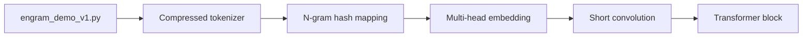

# deepseek-ai/Engram

> Demo code for the paper on Engram conditional memory, for language-model researchers.

## The problem
Transformers have no native primitive for knowledge lookup: they recompute static patterns in their early layers.

## What it actually does
Implements the Engram module: hashed n-grams mapped to an embedding memory, retrieved in constant time then fused into the hidden states. The paper claims a U-shaped allocation law between MoE compute and memory. The code provided is a standalone demo (`engram_demo_v1.py`) where attention and MoE are simulated; it is neither a training run nor a model server.

## How it is wired


## Trying it
```bash
pip install torch numpy transformers sympy
python engram_demo_v1.py
```

## Cost and gotchas
Free. The demo downloads a pretrained tokenizer via transformers. No Engram model weights are published in this repository.

## What it is not
Not a ready-to-use model: the paper's results (Engram-27B) cannot be reproduced with this code.

## Alternatives
No alternative cited in the README.

## For you
Worth watching: read it to understand the idea before it lands in real models, with nothing operational to take from it today.
