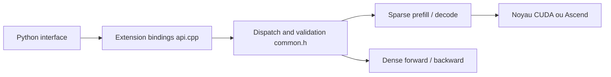

# deepseek-ai/FlashMLA

> DeepSeek's optimized attention kernels for DeepSeek-V4.1 inference on NVIDIA Blackwell GPUs and Ascend NPUs.

## The problem
DeepSeek-V4.1's sparse attention and quantized KV cache only run efficiently with hand-written kernels.

## What it actually does
Provides sparse attention kernels (prefill and decode, FP8/FP4 KV cache), a fused norm-RoPE-attention-FP8 cast kernel, and dense attention with backpropagation. Claims up to 1,460 TFlops in prefill on B200 and 410 TFlops on Ascend 950. Called from PyTorch.

## How it is wired


## Trying it
```bash
git clone https://github.com/deepseek-ai/FlashMLA.git flash-mla
cd flash-mla
git submodule update --init --recursive
pip install -v . --no-build-isolation
python tests/test-sparse-decode.py
```

## Cost and gotchas
Requires an SM100/SM103 GPU or Ascend 950, CUDA 13.1+, PyTorch 2.10+. The 2026-09-30 release drops Hopper and older models and changes the KV cache format: incompatible with previous ones.

## What it is not
Not a full inference engine, only kernels. Useless outside DeepSeek-V4.1 models and the cited hardware.

## Alternatives
The listed per-vendor ports (MetaX-MACA/FlashMLA, MooreThreads/MT-flashMLA, Deep-Spark/FlashMLA, AITER/MLA for AMD).

## For you
Ignore unless you serve DeepSeek-V4.1 on Blackwell: hardware and version too specific, and Hopper is no longer supported.
