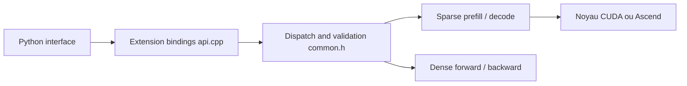

# deepseek-ai/FlashMLA

> Noyaux d'attention optimisés de DeepSeek pour l'inférence de DeepSeek-V4.1 sur GPU NVIDIA Blackwell et NPU Ascend.

## Le problème
L'attention éparse et le cache KV quantifié de DeepSeek-V4.1 ne tournent efficacement qu'avec des noyaux écrits à la main.

## Ce que ça fait vraiment
Fournit des noyaux d'attention éparse (prefill et decode, cache KV FP8/FP4), un noyau fusionné norme-RoPE-attention-cast FP8, et de l'attention dense avec rétropropagation. Annonce jusqu'à 1 460 TFlops en prefill sur B200 et 410 TFlops sur Ascend 950. Appelé depuis PyTorch.

## Comment c'est branché


## Essayer
```bash
git clone https://github.com/deepseek-ai/FlashMLA.git flash-mla
cd flash-mla
git submodule update --init --recursive
pip install -v . --no-build-isolation
python tests/test-sparse-decode.py
```

## Coût et pièges
Exige GPU SM100/SM103 ou Ascend 950, CUDA 13.1+, PyTorch 2.10+. La version du 2026-09-30 retire Hopper et les anciens modèles et change le format du cache KV : incompatible avec les précédentes.

## Ce que ce n'est pas
Pas un moteur d'inférence complet, seulement des noyaux. Inutile hors modèles DeepSeek-V4.1 et hors matériel cité.

## Alternatives
Les ports par fabricant listés (MetaX-MACA/FlashMLA, MooreThreads/MT-flashMLA, Deep-Spark/FlashMLA, AITER/MLA pour AMD).

## Pour toi
À ignorer sauf si tu sers DeepSeek-V4.1 sur Blackwell : matériel et version trop spécifiques, et Hopper n'est plus supporté.

