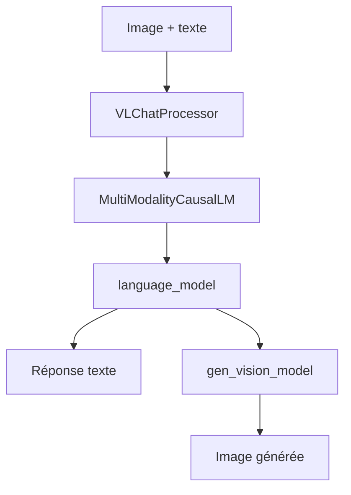

# deepseek-ai/Janus

> Inference code for DeepSeek's Janus multimodal models, for understanding and generating images.

## The problem
Usually you need one model to describe an image and another to create one. Janus wants a single transformer for both tasks.

## What it actually does
There are three variants: Janus and Janus-Pro, autoregressive with decoupled visual encoding, and JanusFlow, which combines the language model with rectified flow.
Weights of 1B, 1.3B and 7B on Hugging Face, with a context of 4096.
The README gives Python examples for image understanding (`VLChatProcessor`) and text-to-image generation.
Gradio and FastAPI demos are provided.

## How it is wired
No component is readable in the diagram. The schema follows the README.


## Trying it
```bash
pip install -e .
pip install -e .[gradio]
python demo/app_januspro.py
python demo/fastapi_app.py
```

## Cost and gotchas
The examples call `.cuda()`, so a GPU is required. JanusFlow also needs the SDXL VAE and `diffusers`.

## What it is not
It is not a maintained library: last push on 2025-02-01. It is not a service: you can only run the demos. The code is under MIT, but the weights have their own license.

## Alternatives
The README names no alternative repository.

## For you
Ignore: research code frozen for over a year, useful only out of curiosity about unified multimodal models.
