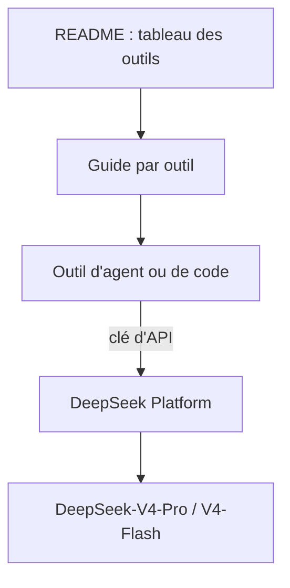

# deepseek-ai/awesome-deepseek-agent

> List of guides for plugging DeepSeek-V4 models into agent tools and coding assistants.

## The problem
Each agent or coding tool is configured differently for a model provider; you have to find each one's procedure.

## What it actually does
A table of about twenty tools (Claude Code, Cline, Codex, Crush, OpenCode, Qwen Code, Reasonix and others), each with a short description and a link to a guide. Each guide covers installation, configuration and first launch with DeepSeek-V4-Pro or DeepSeek-V4-Flash.

## How it is wired

Simplified diagram based on the sheet, no diagram provided.

## Trying it
```bash
# Aucune commande dans le README : ouvrir le guide de l'outil voulu dans le tableau.
```

## Cost and gotchas
You need an API key from the DeepSeek platform (link in the Resources section); model usage is billed to you. No license declared on the repository.

## What it is not
It is not software: no code to run, only links to guides. The content of the guides is not in the README and was not read.

## Alternatives
The listed tools themselves (for example OpenCode or Cline) have their own configuration documentation.

## For you
Worth watching: useful if you want to test DeepSeek in your agent tools, but it is only an index of links with no license.
