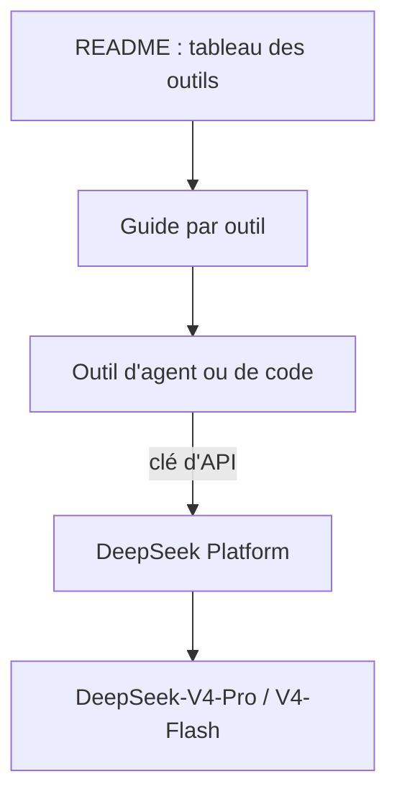

# deepseek-ai/awesome-deepseek-agent

> Liste de guides pour brancher les modèles DeepSeek-V4 sur des outils d'agents et d'assistants de code.

## Le problème
Chaque outil d'agent ou de codage se configure autrement pour un fournisseur de modèle ; il faut retrouver la procédure de chacun.

## Ce que ça fait vraiment
Un tableau d'une vingtaine d'outils (Claude Code, Cline, Codex, Crush, OpenCode, Qwen Code, Reasonix et d'autres), chacun avec une courte description et un lien vers un guide. Chaque guide couvre installation, configuration et premier lancement avec DeepSeek-V4-Pro ou DeepSeek-V4-Flash.

## Comment c'est branché

Schéma simplifié d'après la fiche, sans diagramme fourni.

## Essayer
```bash
# Aucune commande dans le README : ouvrir le guide de l'outil voulu dans le tableau.
```

## Coût et pièges
Il faut une clé d'API de la plateforme DeepSeek (lien dans la section Resources) ; l'usage des modèles est facturé à ta charge. Aucune licence déclarée sur le dépôt.

## Ce que ce n'est pas
Ce n'est pas un logiciel : aucun code à exécuter, seulement des liens vers des guides. Le contenu des guides n'est pas dans le README et n'a pas été lu.

## Alternatives
Les outils listés eux-mêmes (par exemple OpenCode ou Cline) ont leur propre documentation de configuration.

## Pour toi
À surveiller : utile si tu veux tester DeepSeek dans tes outils d'agents, mais ce n'est qu'un index de liens sans licence.

