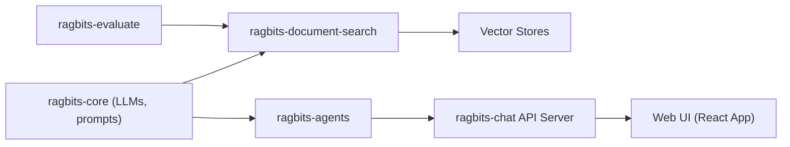

# deepsense-ai/ragbits

> Modular Python building blocks for GenAI applications: LLM, RAG, agents, evaluation and chat interface.

## The problem
Building a RAG or agentic application means assembling prompts, embeddings, vector storage, ingestion and an interface.

## What it actually does
Monorepo of separately installable packages: `ragbits-core` (typed prompts, LLMs via LiteLLM, vector stores including Qdrant and PgVector), `document-search` (ingestion of 20+ formats via Docling or Unstructured, Ray optional), `agents` (A2A, MCP), `evaluate`, `guardrails`, `chat` (API + React UI) and `cli`. OpenTelemetry tracing.

## How it is wired


## Trying it
```bash
pip install ragbits
pip install ragbits --pre
uvx create-ragbits-app
```

## Cost and gotchas
API key for the LLM provider and embeddings (the examples use `gpt-4.1-nano` and `text-embedding-3-small`). The `InMemoryVectorStore` in the examples persists nothing.

## What it is not
Not a finished product: a toolbox whose choices (parser, vector database, evals) remain to be made. The architecture graph is a generic guide, not inspected in the code.

## Alternatives
No alternative named in the README.

## For you
Worth watching: a clean, modular base for RAG in Python, to compare with what your team already uses before migrating.
