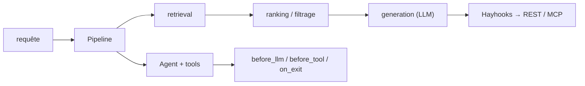

# deepset-ai/haystack

> Python orchestration framework for RAG pipelines and agents, with explicit control of context.

## The problem
"Magic" RAG chains hide where the context goes: impossible to know what was retrieved or why.
Switching model or vector database often forces you to rewrite the whole system.

## What it actually does
Modular pipelines make retrieval, ranking, filtering, memory, routing and generation explicit, with loops and branches.
The same `Pipeline` runs synchronously or asynchronously and streams token by token; an `Agent` can launch concurrent tool calls.
Lifecycle hooks (`before_llm`, `before_tool`, `on_exit`) for guardrails, plus tracking of `step_count`, `token_usage` and tool calls.
Agent Pack provides ready-made agents (deep research, advanced RAG); `SkillToolset` only injects skill descriptions when needed.

## How it is wired


## Trying it
```sh
pip install haystack-ai
pip install --pre haystack-ai
```

## Cost and gotchas
The library is free; the models (OpenAI, Anthropic, Mistral, Bedrock, Azure…) are billed by their providers.
Haystack collects anonymous statistics when components are initialized — how to disable it is documented outside the README.

## What it is not
It is not an application: no UI, no service; exposing a pipeline over REST or MCP goes through Hayhooks.
It is not stable across major versions: the current version is 3.0, announced as a breaking change.
It is not a search engine: vector and document databases remain external dependencies.

## Alternatives
Hayhooks: the companion that exposes pipelines and agents as HTTP endpoints, MCP or OpenAI-compatible chat.

## For you
The framework to prefer when you want to see and control every step of RAG rather than put up with an abstraction.
