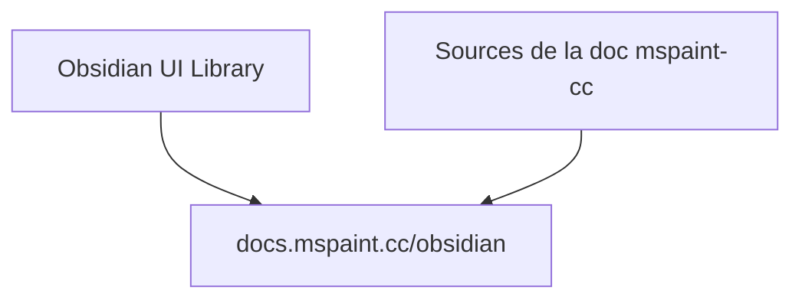

# deividcomsono/Obsidian

> Graphical interface library named Obsidian, documented on an external site.

## The problem
Not documented in the README, which contains only two links.

## What it actually does
The README only announces an "Obsidian UI Library" and points to docs.mspaint.cc/obsidian. The language, the functions and the audience are not documented here.

## How it is wired
Simplified diagram based on the sheet, no diagram provided.

## Trying it
No command documented in the README.

## Cost and gotchas
Nothing indicated about cost or installation. All useful information is on the external documentation site.

## What it is not
Not the Obsidian note-taking app: only the name is the same. The README is too short to conclude any further.

## Alternatives
No alternative named in the README.

## For you
Ignore: the README does not say what the library is for, which makes it impossible to tie to a data, AI or MLOps need.
