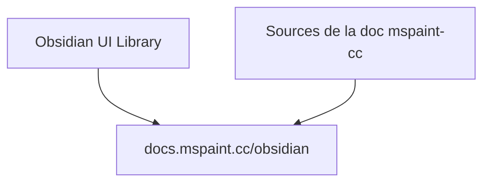

# deividcomsono/Obsidian

> Bibliothèque d'interface graphique nommée Obsidian, documentée sur un site externe.

## Le problème
Non documenté dans le README, qui ne contient que deux liens.

## Ce que ça fait vraiment
Le README annonce seulement une « Obsidian UI Library » et renvoie vers docs.mspaint.cc/obsidian. Le langage, les fonctions et le public ne sont pas documentés ici.

## Comment c'est branché
Schéma simplifié d'après la fiche, sans diagramme fourni.

## Essayer
Aucune commande documentée dans le README.

## Coût et pièges
Rien d'indiqué sur le coût ni sur l'installation. Toute information utile se trouve sur le site de documentation externe.

## Ce que ce n'est pas
Pas l'application de notes Obsidian : seul le nom est identique. Le README est trop court pour trancher davantage.

## Alternatives
Aucune alternative nommée dans le README.

## Pour toi
À ignorer : le README ne dit pas à quoi sert la bibliothèque, ce qui ne permet pas de la relier à un besoin data, IA ou MLOps.

