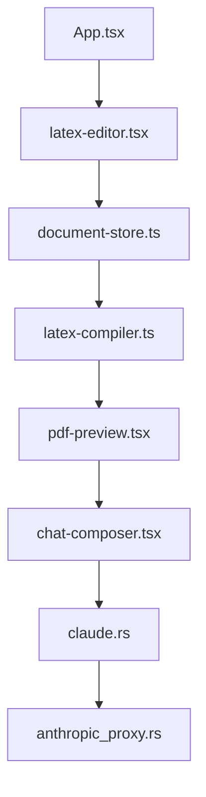

# delibae/claude-prism

> Desktop application to write scientific papers in LaTeX with Claude, local compilation.

## The problem
Online LaTeX workspaces send your files to the cloud, and the AI assistant there is isolated from the rest of your working environment.

## What it actually does
A Tauri 2 (Rust) application that edits and compiles LaTeX locally with Tectonic, displays the PDF via MuPDF and embeds a Claude chat. Claude proposes changes that you accept or reject block by block. It creates a Python environment with uv, installs scientific skills and keeps history in a local Git repository. Content read by Claude is sent to the Anthropic API.

## How it is wired
Simplified diagram based on the code's diagram.



## Trying it
```bash
# Aucune commande dans le README : télécharger le build depuis GitHub Releases
```

## Cost and gotchas
Calls to Claude go through your Anthropic account, billed by usage. The first launch downloads the LaTeX packages, then compilation works offline.

## What it is not
It is not 100% offline: the prompts and the files read by Claude go to Anthropic. It is not a LaTeX editor independent of Claude; the assistant is the core of the product.

## Alternatives
- OpenAI Prism: proprietary cloud LaTeX workspace, no installation, but it sends your files away.
- Open Prism (assistant-ui): the project this one comes from.

## For you
Worth watching: useful if you write publications with Claude and want to keep the sources on your disk, but the repository is maintained by a single person.
