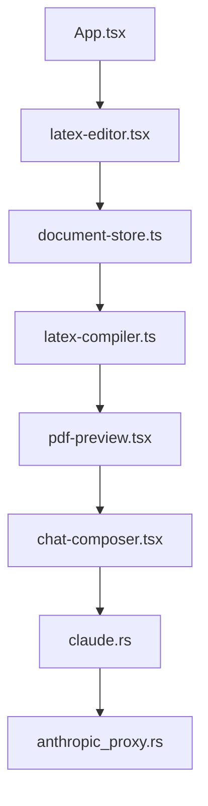

# delibae/claude-prism

> Application de bureau pour rédiger des articles scientifiques en LaTeX avec Claude, compilation locale.

## Le problème
Les espaces LaTeX en ligne envoient tes fichiers dans le cloud, et l'assistant IA y est isolé du reste de ton environnement de travail.

## Ce que ça fait vraiment
Une application Tauri 2 (Rust) qui édite et compile le LaTeX en local avec Tectonic, affiche le PDF via MuPDF et embarque un chat Claude. Claude propose des modifications acceptées ou refusées par bloc. Elle crée un environnement Python avec uv, installe des skills scientifiques et garde l'historique dans un dépôt Git local. Les contenus lus par Claude partent vers l'API d'Anthropic.

## Comment c'est branché
Schéma simplifié d'après le diagramme du code.



## Essayer
```bash
# Aucune commande dans le README : télécharger le build depuis GitHub Releases
```

## Coût et pièges
Les appels à Claude passent par ton compte Anthropic, facturés selon l'usage. Le premier lancement télécharge les paquets LaTeX, puis la compilation fonctionne hors ligne.

## Ce que ce n'est pas
Ce n'est pas 100 % hors ligne : les prompts et les fichiers lus par Claude vont chez Anthropic. Ce n'est pas un éditeur LaTeX indépendant de Claude, l'assistant est le cœur du produit.

## Alternatives
- OpenAI Prism : espace LaTeX cloud propriétaire, sans installation, mais avec envoi de tes fichiers.
- Open Prism (assistant-ui) : projet dont celui-ci est issu.

## Pour toi
À surveiller : utile si tu rédiges des publications avec Claude et tiens à garder les sources sur ton disque, mais le dépôt est tenu par une seule personne.

