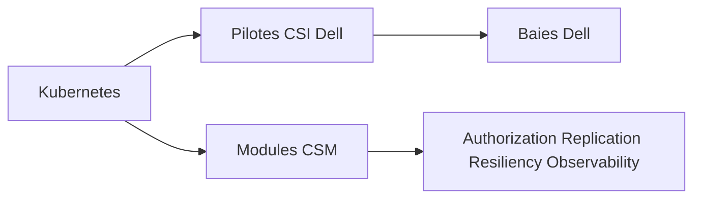

# dell/csm

> Dell suite of Kubernetes storage modules and drivers, for customers of Dell arrays.

## The problem
Connecting Dell storage arrays to Kubernetes requires CSI drivers and security, replication and observability features.

## What it actually does
This repository mostly contains the definition of the base image for the CSM components. The modules listed: Authorization, Observability, Replication, Resiliency, CSI drivers for PowerFlex, PowerMax, PowerScale, PowerStore and Unity, plus a COSI driver. The details are in the external documentation.

## How it is wired
Simplified diagram based on the fiche, no diagram provided.



## Trying it
```bash
make docker
```
Built with buildah on Red Hat Enterprise Linux 9.0 or later.

## Cost and gotchas
Build limited to RHEL 9 and buildah. Only useful with Dell storage hardware.

## What it is not
It is not generic storage: it assumes Dell products. The drivers themselves are in other repositories.

## Alternatives
No alternative named in the README.

## For you
Ignore: reserved for Dell fleets, of no interest until you have that hardware.
