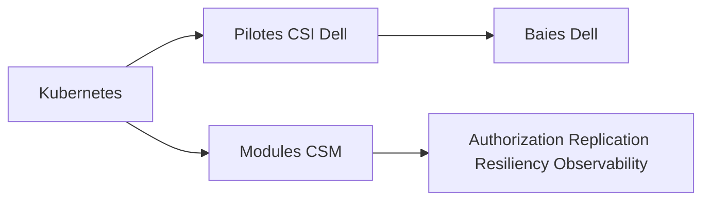

# dell/csm

> Suite Dell de modules et pilotes de stockage Kubernetes, pour les clients de baies Dell.

## Le problème
Brancher des baies de stockage Dell à Kubernetes demande des pilotes CSI et des fonctions de sécurité, de réplication et d'observabilité.

## Ce que ça fait vraiment
Ce dépôt contient surtout la définition de l'image de base des composants CSM. Les modules listés : Authorization, Observability, Replication, Resiliency, pilotes CSI pour PowerFlex, PowerMax, PowerScale, PowerStore et Unity, plus un pilote COSI. Le détail est dans la documentation externe.

## Comment c'est branché
Schéma simplifié d'après la fiche, sans diagramme fourni.



## Essayer
```bash
make docker
```
Construction avec buildah sur RedHat Enterprise Linux 9.0 ou plus.

## Coût et pièges
Build limité à RHEL 9 et buildah. Utile seulement avec du matériel de stockage Dell.

## Ce que ce n'est pas
Ce n'est pas un stockage générique : il suppose des produits Dell. Les pilotes eux-mêmes sont dans d'autres dépôts.

## Alternatives
Aucune alternative nommée dans le README.

## Pour toi
Ignorer : réservé aux parcs Dell, sans intérêt tant que tu n'as pas ce matériel.

