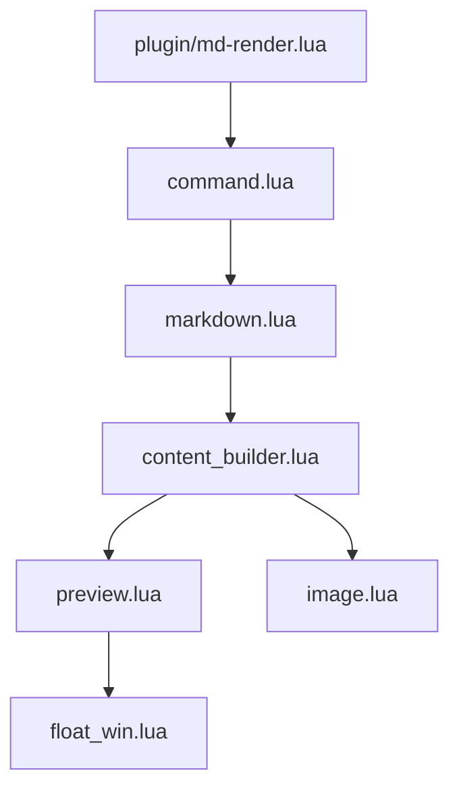

# delphinus/md-render.nvim

> Markdown rendering engine for Neovim: floating preview, pager and images in the terminal.

## The problem
Reading rich Markdown (tables, callouts, images, CJK) in a terminal without a browser and without modifying the buffer.

## What it actually does
Parses Markdown, assembles the content with line wrapping, then displays it in a floating window, tab or pager. Images, videos, Mermaid and PlantUML via the Kitty graphics protocol. Telescope and Snacks integrations.

## How it is wired


## Trying it
```bash
git clone https://github.com/delphinus/md-render.nvim
cd md-render.nvim
nvim +"MdRender pager" assets/showcase.md
```

## Cost and gotchas
Free. Neovim 0.12 or later required; images and videos require a Kitty terminal, ffmpeg or ImageMagick.

## What it is not
Not a Markdown editor: read-only rendering. Not a browser preview.

## Alternatives
markdown-preview.nvim: faithful browser rendering.
render-markdown.nvim: rendering in the editing buffer.
mcat: terminal rendering, less layout.

## For you
Worth watching: handy if you read your READMEs and notes in Neovim, otherwise no data/AI stake.
