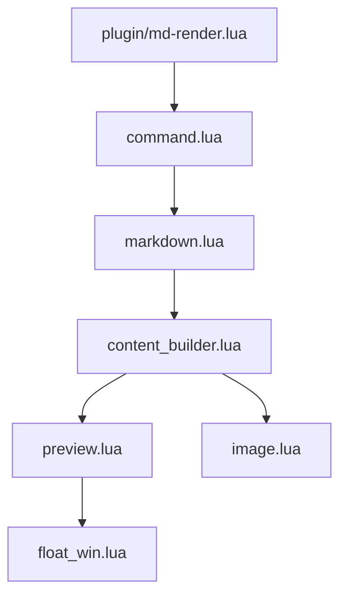

# delphinus/md-render.nvim

> Moteur de rendu Markdown pour Neovim : aperçu flottant, pager et images dans le terminal.

## Le problème
Lire du Markdown riche (tableaux, callouts, images, CJK) dans un terminal sans navigateur ni modifier le buffer.

## Ce que ça fait vraiment
Analyse le Markdown, assemble le contenu avec retours à la ligne, puis l'affiche en fenêtre flottante, onglet ou pager. Images, vidéos, Mermaid et PlantUML via le protocole graphique Kitty. Intégrations Telescope et Snacks.

## Comment c'est branché


## Essayer
```bash
git clone https://github.com/delphinus/md-render.nvim
cd md-render.nvim
nvim +"MdRender pager" assets/showcase.md
```

## Coût et pièges
Gratuit. Neovim 0.12 ou plus requis ; images et vidéos demandent un terminal Kitty, ffmpeg ou ImageMagick.

## Ce que ce n'est pas
Pas un éditeur de Markdown : rendu en lecture seule. Pas un aperçu navigateur.

## Alternatives
markdown-preview.nvim : rendu navigateur fidèle.
render-markdown.nvim : rendu dans le buffer d'édition.
mcat : rendu terminal, moins de mise en page.

## Pour toi
À surveiller : pratique si tu lis tes README et notes dans Neovim, sinon sans enjeu data/IA.

