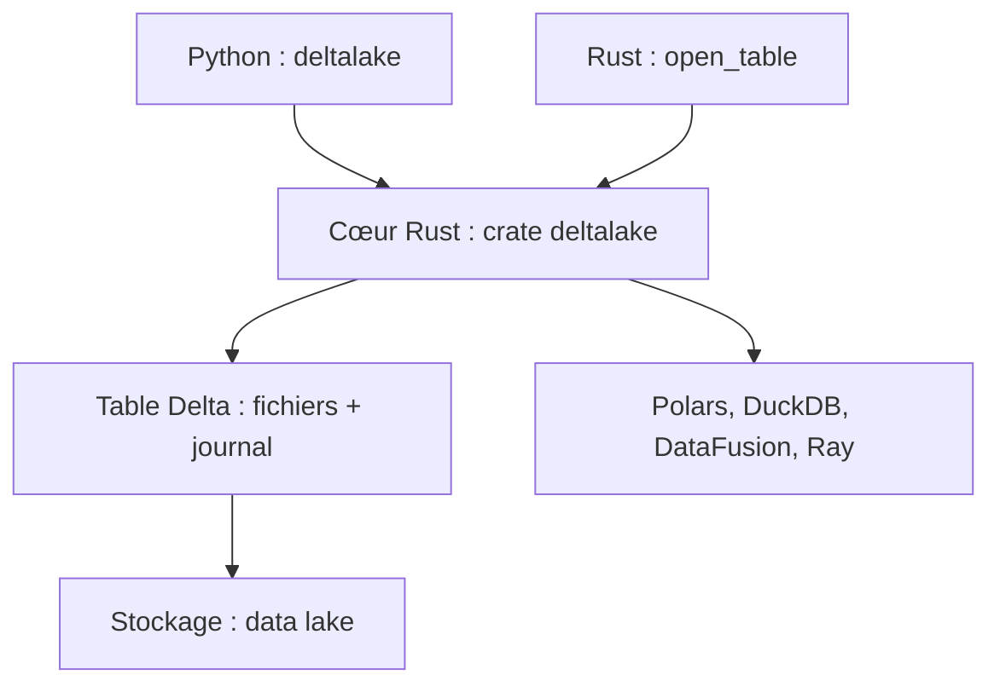

# delta-io/delta-rs

> Rust library, with Python bindings, to read and write Delta Lake tables without Spark.

## The problem
Delta Lake is mostly accessible through Spark; reading or writing a table from Python or Rust without a cluster is painful.

## What it actually does
It natively implements the Delta Lake format: ACID transactions, enforced schema, and a high-level operations API. `write_deltalake` writes a pandas DataFrame and `DeltaTable` reads it back. It integrates with DataFusion, Polars, DuckDB, Dask, Daft and Ray.

## How it is wired
Simplified diagram based on the sheet, no diagram provided.



## Trying it
```bash
pip install deltalake
cargo add deltalake
```
```python
from deltalake import DeltaTable, write_deltalake
write_deltalake("./data/delta", df)
dt = DeltaTable("./data/delta")
```

## Cost and gotchas
Free. Feature support varies: check the feature table before counting on a specific operation.

## What it is not
Not a query engine: it reads and writes the tables, the computation comes from the connected tool.

## Alternatives
No alternative named in the README (Apache Spark is cited as a compatible engine).

## For you
Adopt: direct access to Delta tables from Python or Rust without Spark, with a familiar API and a broad ecosystem.
