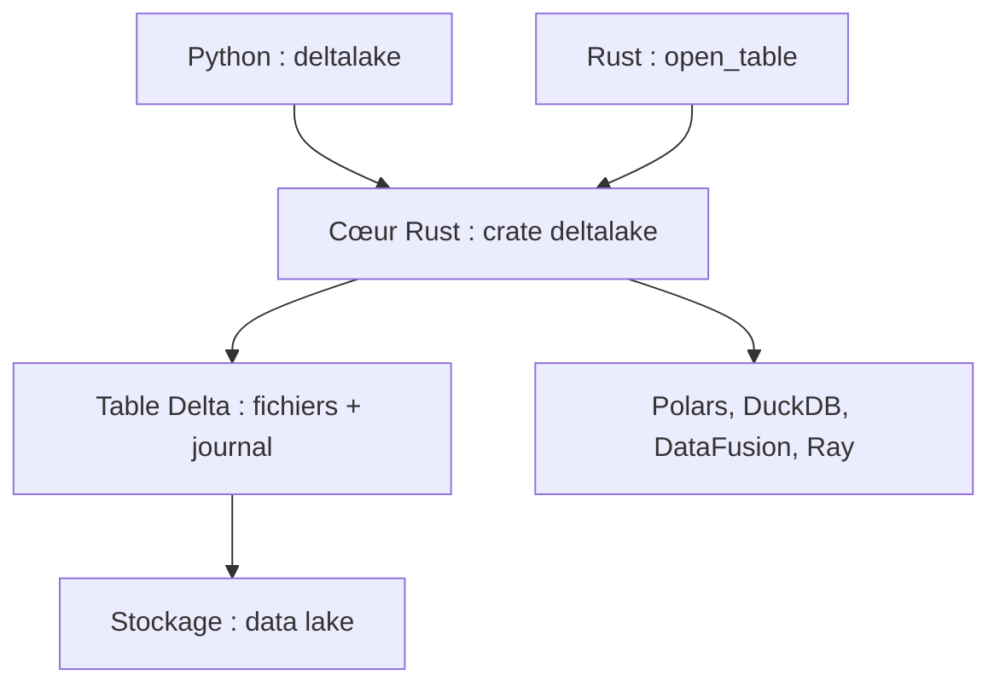

# delta-io/delta-rs

> Bibliothèque Rust, avec liaisons Python, pour lire et écrire des tables Delta Lake sans Spark.

## Le problème
Delta Lake est surtout accessible via Spark ; lire ou écrire une table depuis Python ou Rust sans cluster est pénible.

## Ce que ça fait vraiment
Elle implémente nativement le format Delta Lake : transactions ACID, schéma imposé, et une API d'opérations de haut niveau. `write_deltalake` écrit un DataFrame pandas et `DeltaTable` le relit. Elle s'intègre à DataFusion, Polars, DuckDB, Dask, Daft et Ray.

## Comment c'est branché
Schéma simplifié d'après la fiche, sans diagramme fourni.



## Essayer
```bash
pip install deltalake
cargo add deltalake
```
```python
from deltalake import DeltaTable, write_deltalake
write_deltalake("./data/delta", df)
dt = DeltaTable("./data/delta")
```

## Coût et pièges
Gratuit. Le support des fonctions varie : voir le tableau des fonctionnalités avant de compter sur une opération précise.

## Ce que ce n'est pas
Pas un moteur de requêtes : il lit et écrit les tables, le calcul vient de l'outil branché.

## Alternatives
Aucune alternative nommée dans le README (Apache Spark est cité comme moteur compatible).

## Pour toi
À adopter : accès direct aux tables Delta depuis Python ou Rust sans Spark, avec une API familière et un écosystème large.

