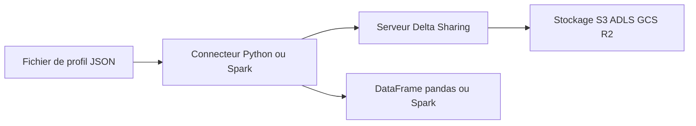

# delta-io/delta-sharing

> Open data-sharing protocol, with Python and Spark connectors, for data providers and consumers.

## The problem
Sharing large datasets without every consumer having to deploy the same compute platform.

## What it actually does
- REST protocol; the server gives access to files in cloud storage (S3, ADLS, GCS, Cloudflare R2).
- Python connector: reads a shared table as a pandas or Spark DataFrame, with changes (CDF).
- Spark connector: SQL, Python, Scala, Java, R, streaming reads.
- Reference server for testing: basic authorization token, to be placed behind a secure proxy.
- The README says this server is not a complete implementation of a secure web server.

## How it is wired


## Trying it
```bash
pip3 install delta-sharing
```
```python
import delta_sharing
client = delta_sharing.SharingClient(profile_file)
delta_sharing.load_as_pandas(table_url, limit=10)
```

## Cost and gotchas
Free. Python 3.8 or later; on Linux glibc 2.31 or later, otherwise Rust to build a package. Cloud storage is at your expense.

## What it is not
Not a data catalog or a warehouse. The provided server is an example, not hardened for public exposure.

## Alternatives
Services managed by vendors, for example Databricks (cited in the README).

## For you
Adopt for reading shared tables from pandas or Spark without deploying infrastructure on the consumer side: little setup, open protocol.
