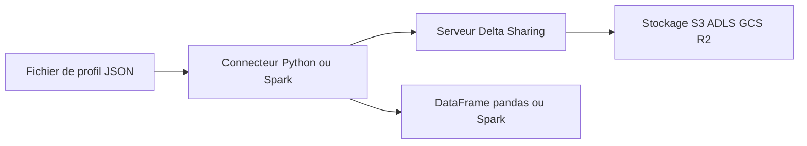

# delta-io/delta-sharing

> Protocole ouvert de partage de données, avec connecteurs Python et Spark, pour fournisseurs et consommateurs de données.

## Le problème
Partager de gros jeux de données sans que chaque consommateur doive déployer la même plateforme de calcul.

## Ce que ça fait vraiment
- Protocole REST ; le serveur donne un accès aux fichiers du stockage cloud (S3, ADLS, GCS, Cloudflare R2).
- Connecteur Python : lit une table partagée comme DataFrame pandas ou Spark, avec changements (CDF).
- Connecteur Spark : SQL, Python, Scala, Java, R, lecture en flux.
- Serveur de référence pour tests : jeton d'autorisation basique, à placer derrière un proxy sécurisé.
- Le README dit que ce serveur n'est pas une implémentation complète de serveur web sécurisé.

## Comment c'est branché


## Essayer
```bash
pip3 install delta-sharing
```
```python
import delta_sharing
client = delta_sharing.SharingClient(profile_file)
delta_sharing.load_as_pandas(table_url, limit=10)
```

## Coût et pièges
Gratuit. Python 3.8 ou plus ; sous Linux glibc 2.31 ou plus, sinon Rust pour compiler un paquet. Le stockage cloud est à ta charge.

## Ce que ce n'est pas
Pas un catalogue de données ni un entrepôt. Le serveur fourni est un exemple, non durci pour l'exposition publique.

## Alternatives
Services gérés par des fournisseurs, par exemple Databricks (cité dans le README).

## Pour toi
À adopter pour lire des tables partagées depuis pandas ou Spark sans déployer d'infra côté consommateur : peu d'installation, protocole ouvert.

