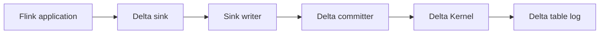

# delta-io/delta

> Transactional (ACID) storage layer for data lakes, with Spark, Flink, Trino and others.

## The problem
A file-based lake offers no transactions, no versioning, and no safe concurrent writes.

## What it actually does
Table format with a transaction log, serializability under concurrency, guaranteed backward compatibility of tables. Connectors for Spark, Flink (preview), Hive, Presto, Trino; Standalone library in Java/Scala; Hudi and Iceberg integrations; shared Kernel core. The storage must provide atomic visibility, mutual exclusion and consistent listing.

## How it is wired


## Trying it
```bash
build/sbt compile
build/sbt package
build/sbt test
```

## Cost and gotchas
Free, Apache-2.0. Java 17 minimum for the build (the README also cites JDK 11 for Python tests: inconsistent). The underlying storage must respect the atomicity guarantees.

## What it is not
Not a compute engine: it relies on Spark, Flink or Trino. The Rust/Python libraries live in delta-rs, another repository.

## Alternatives
delta-rs (Rust, with Python and Ruby bindings), cited in the README.

## For you
Adopt: a reliable and widespread table format for training datasets and pipelines.
