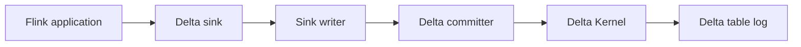

# delta-io/delta

> Couche de stockage transactionnelle (ACID) pour lacs de données, avec Spark, Flink, Trino et d'autres.

## Le problème
Un lac de fichiers n'offre ni transactions, ni versionnage, ni écritures concurrentes sûres.

## Ce que ça fait vraiment
Format de table avec journal de transactions, sérialisabilité en concurrence, rétrocompatibilité garantie des tables. Connecteurs Spark, Flink (aperçu), Hive, Presto, Trino ; bibliothèque Standalone en Java/Scala ; intégrations Hudi et Iceberg ; noyau Kernel partagé. Le stockage doit fournir visibilité atomique, exclusion mutuelle et listage cohérent.

## Comment c'est branché


## Essayer
```bash
build/sbt compile
build/sbt package
build/sbt test
```

## Coût et pièges
Gratuit, Apache-2.0. Java 17 au minimum pour le build (le README cite aussi JDK 11 pour les tests Python : incohérent). Le stockage sous-jacent doit respecter les garanties d'atomicité.

## Ce que ce n'est pas
Pas un moteur de calcul : il s'appuie sur Spark, Flink ou Trino. Les bibliothèques Rust/Python vivent dans delta-rs, autre dépôt.

## Alternatives
delta-rs (Rust, avec liaisons Python et Ruby), cité dans le README.

## Pour toi
Adopter : format de tables fiable et très répandu pour les jeux de données d'entraînement et les pipelines.

