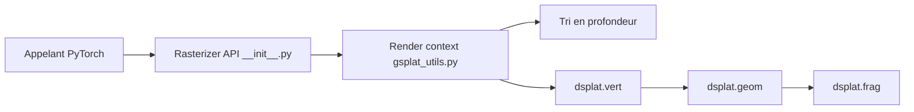

# dendenxu/fast-gaussian-rasterization

> Gaussian Splatting rasterizer using OpenGL shaders, direct rendering, no backward pass.

## The problem
The original CUDA rasterizer (diff-gaussian-rasterization) is slow for high-resolution interactive rendering.

## What it actually does
Replaces the `diff_gaussian_rasterization` import with `fast_gauss`. Depth sorting is done on the GPU via CUDA, then OpenGL vertex/geometry/fragment shaders rasterize. Claimed 5 to 10 times faster when the framebuffer is written directly, 2 to 3 times for offline rendering. No backward pass, so no training.

## How it is wired


## Trying it
```bash
pip install fast_gauss
```
Then replace `from diff_gaussian_rasterization import ...` with `from fast_gauss import GaussianRasterizationSettings, GaussianRasterizer`.

## Cost and gotchas
NVIDIA GPU with CUDA-OpenGL interop required; neither WSL nor macOS. Offline: the EGL environment is sometimes difficult. Alpha channel reported as broken.

## What it is not
Not a splat training tool. On very dense point clouds (> 1M points), the original CUDA one may be faster.

## Alternatives
diff-gaussian-rasterization (the original) and diff_gauss, cited as sources of the algorithm.

## For you
Worth watching: interesting for viewing splats in real time, unusable for training, and not updated since February 2025.
