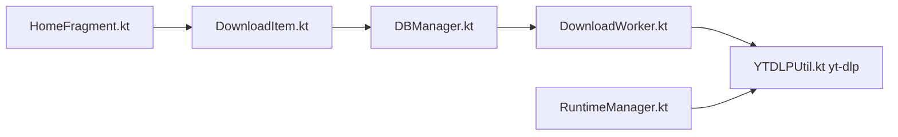

# deniscerri/ytdlnis

> Android application that downloads audio and video from over 1000 sites, built on yt-dlp.

## The problem
Using yt-dlp on a phone from the command line is impractical.

## What it actually does
Material You interface on top of yt-dlp: persistent queue (WorkManager), playlists, scheduling, cookies, trimming, SponsorBlock, metadata, built-in terminal, intents for Tasker. Adds optional runtimes (Python, Node, FFmpeg, Aria2c).

## How it is wired


## Trying it
```bash
# Aucune commande shell : l'application s'installe depuis les sources officielles listées.
```

## Cost and gotchas
Free. The README warns that only its links are trustworthy sources; check the signature (fingerprints provided).

## What it is not
Not a standalone extractor: it delegates to yt-dlp. Android 7+ only. Compliance with sites' terms: not documented.

## Alternatives
No alternative named in the README.

## For you
Ignore: consumer Android tool with no data/AI/MLOps use.
