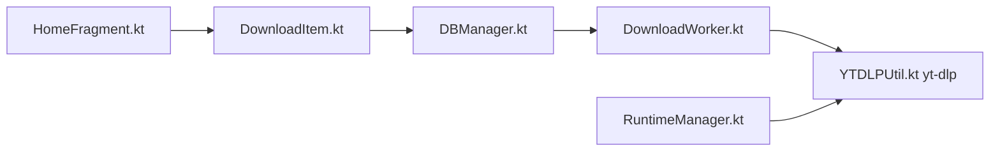

# deniscerri/ytdlnis

> Application Android qui télécharge audio et vidéo depuis plus de 1000 sites en s'appuyant sur yt-dlp.

## Le problème
Utiliser yt-dlp sur un téléphone en ligne de commande est peu pratique.

## Ce que ça fait vraiment
Interface Material You au-dessus de yt-dlp : file d'attente persistante (WorkManager), listes de lecture, planification, cookies, découpage, SponsorBlock, métadonnées, terminal intégré, intents pour Tasker. Ajoute des runtimes optionnels (Python, Node, FFmpeg, Aria2c).

## Comment c'est branché


## Essayer
```bash
# Aucune commande shell : l'application s'installe depuis les sources officielles listées.
```

## Coût et pièges
Gratuit. Le README avertit que seuls ses liens sont des sources fiables ; vérifier la signature (empreintes fournies).

## Ce que ce n'est pas
Pas un extracteur propre : il délègue à yt-dlp. Android 7+ uniquement. Respect des conditions des sites : non documenté.

## Alternatives
Aucune alternative nommée dans le README.

## Pour toi
À ignorer : outil grand public Android sans usage data/IA/MLOps.

