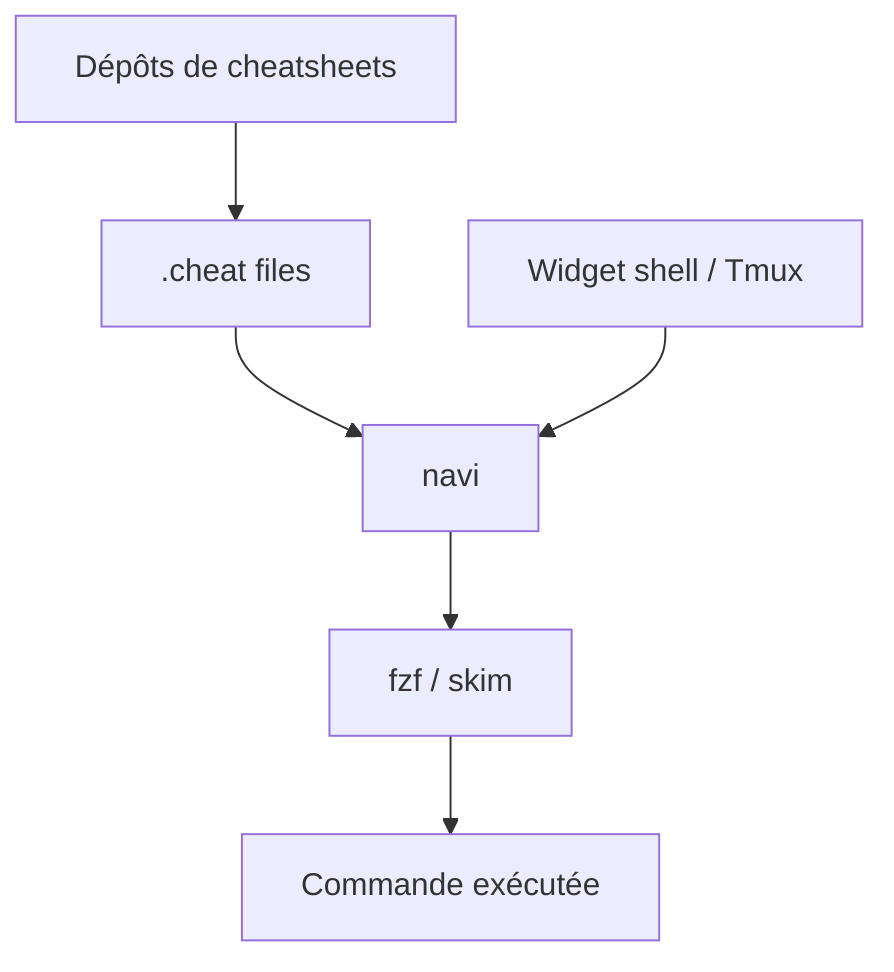

# denisidoro/navi

> Interactive command-line cheatsheet tool for finding and running shell commands with suggested values.

## The problem
Memorizing the options of dozens of CLIs, and copying the output of intermediate commands by hand.

## What it actually does
Browses `.cheat` sheets (written or downloaded), shows suggested arguments in a list and runs the command. Relies on fzf or skim. Usable as a command, shell or Tmux widget, alias or script. Sheets are stored in `~/.local/share/navi/cheats/`.

## How it is wired
Simplified diagram based on the sheet, no diagram provided.



## Trying it
```sh
brew install navi
navi --help
```

## Cost and gotchas
Free. fzf or skim is required under the hood. The README states a maintenance mode: fixes only, no new features planned.

## What it is not
Not a shell history manager. Not shipped with all the sheets: they are downloaded or written.

## Alternatives
- ezlo: cited in the README as a more modern alternative.
- tldr and cheat.sh: reusable sources of sheets.

## For you
Worth watching: handy for everyday Docker, git or kubectl commands in MLOps, but the tool is in maintenance and the README already cites a successor.
