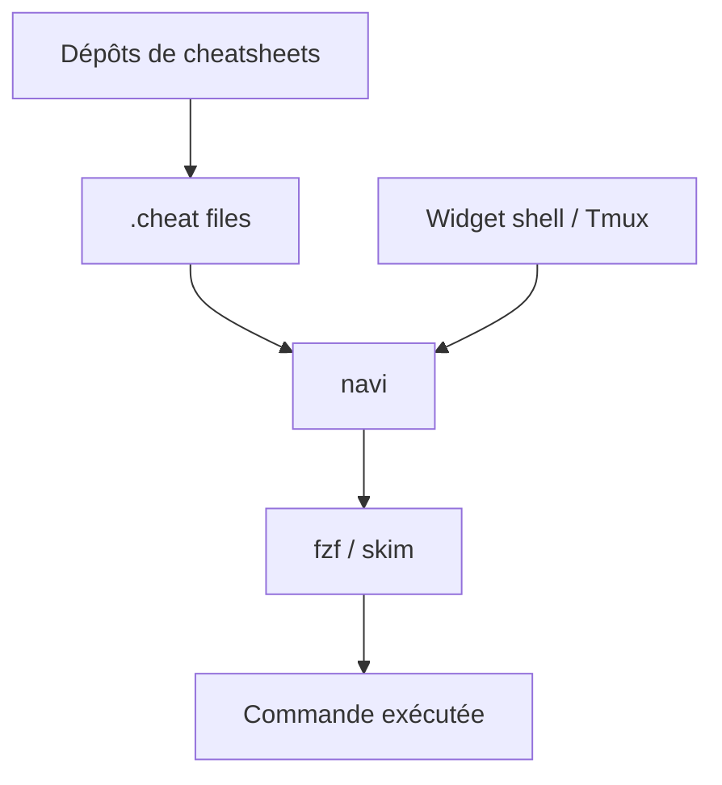

# denisidoro/navi

> Aide-mémoire interactif en ligne de commande, pour retrouver et lancer des commandes shell avec des valeurs suggérées.

## Le problème
Retenir par cœur les options de dizaines de CLI, et recopier à la main les sorties de commandes intermédiaires.

## Ce que ça fait vraiment
Parcourt des fiches `.cheat` (écrites ou téléchargées), affiche les arguments suggérés dans une liste et exécute la commande. S'appuie sur fzf ou skim. Utilisable en commande, widget shell ou Tmux, alias ou script. Les fiches sont dans `~/.local/share/navi/cheats/`.

## Comment c'est branché
Schéma simplifié d'après la fiche, sans diagramme fourni.



## Essayer
```sh
brew install navi
navi --help
```

## Coût et pièges
Gratuit. fzf ou skim nécessaire sous le capot. Le README indique un mode maintenance : corrections seulement, aucune nouvelle fonction prévue.

## Ce que ce n'est pas
Pas un gestionnaire d'historique shell. Pas fourni avec toutes les fiches : elles se téléchargent ou s'écrivent.

## Alternatives
- ezlo : cité dans le README comme alternative plus moderne.
- tldr et cheat.sh : sources de fiches réutilisables.

## Pour toi
À surveiller : pratique pour les commandes Docker, git ou kubectl du quotidien MLOps, mais l'outil est en maintenance et le README cite déjà un successeur.

