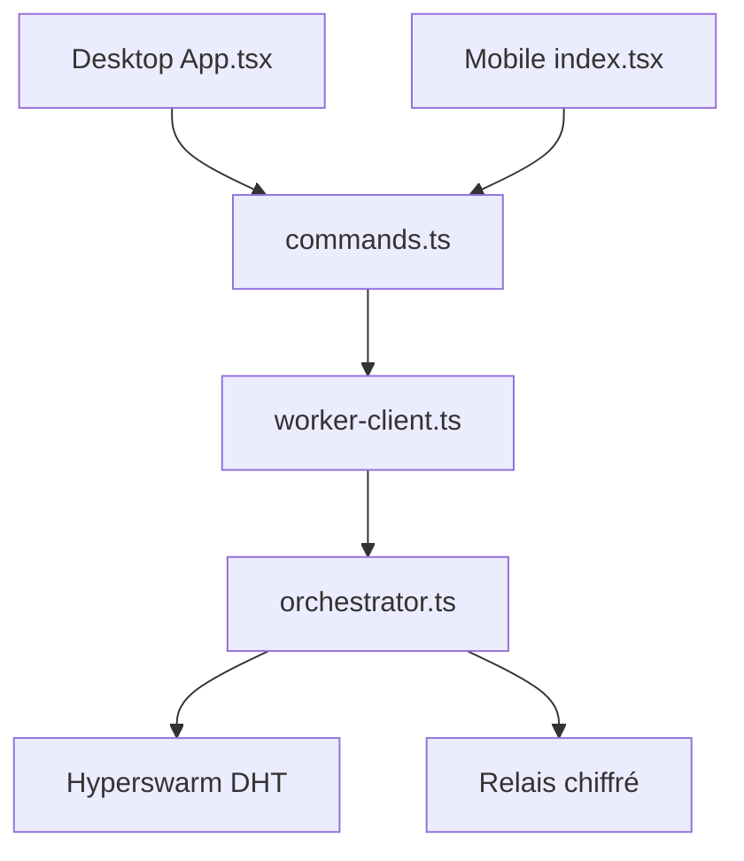

# denislupookov/altersend

> Peer-to-peer file transfer app with end-to-end encryption, no account and no cloud storage.

## The problem
Sending a large file means uploading it to a third party (WeTransfer, Dropbox, Google Drive) before the recipient can download it.

## What it actually does
Files go directly from one device to another, via a join code (or QR) or one-time pairing. Discovery uses Hyperswarm (DHT), the channel is encrypted with Noise, and hashing is BLAKE2b per chunk; an encrypted relay serves as a fallback behind a symmetric NAT. Browser receiver, desktop clients (Electron) and mobile (React Native).

## How it is wired


## Trying it
```bash
brew install --cask altersend
git clone https://github.com/denislupookov/altersend.git && cd altersend
npm install
npm run dev
```

## Cost and gotchas
Free. Building from source: Node.js 20 or later and npm 10; mobile with Xcode or Android Studio. The public bootstrap nodes and the relay are dependencies; Sentry error reports are disabled by default. A license is present but not identified (the text claims Apache-2.0).

## What it is not
Not storage nor folder synchronization: the transfer is one-off, and both parties must be reachable.

## Alternatives
No alternative named in the README (WeTransfer, Dropbox, Google Drive are cited as the services it replaces).

## For you
Keep an eye on it: handy for exchanging large datasets without the cloud, but a young project with a single maintainer.
