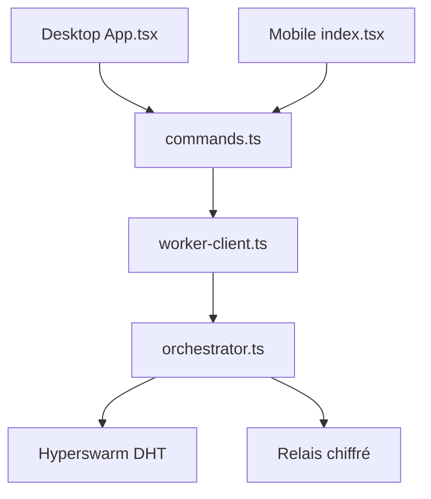

# denislupookov/altersend

> Application de transfert de fichiers pair à pair chiffré de bout en bout, sans compte ni stockage cloud.

## Le problème
Envoyer un gros fichier oblige à le téléverser chez un tiers (WeTransfer, Dropbox, Google Drive) avant que le destinataire ne le télécharge.

## Ce que ça fait vraiment
Les fichiers passent directement d'un appareil à l'autre, par code de jointure (ou QR) ou appairage unique. Découverte via Hyperswarm (DHT), canal chiffré Noise, hachage BLAKE2b par morceau ; un relais chiffré sert de secours derrière un NAT symétrique. Récepteur navigateur, clients bureau (Electron) et mobile (React Native).

## Comment c'est branché


## Essayer
```bash
brew install --cask altersend
git clone https://github.com/denislupookov/altersend.git && cd altersend
npm install
npm run dev
```

## Coût et pièges
Gratuit. Compilation du code : Node.js 20 ou plus et npm 10 ; mobile avec Xcode ou Android Studio. Les nœuds d'amorçage publics et le relais sont des dépendances ; les rapports d'erreur Sentry sont désactivés par défaut. Licence présente mais non identifiée (le texte annonce Apache-2.0).

## Ce que ce n'est pas
Pas un stockage ni une synchronisation de dossiers : le transfert est ponctuel, et les deux parties doivent être joignables.

## Alternatives
Aucune alternative nommée dans le README (WeTransfer, Dropbox, Google Drive cités comme services remplacés).

## Pour toi
À surveiller : pratique pour échanger de gros jeux de données sans cloud, mais jeune projet à mainteneur unique.

