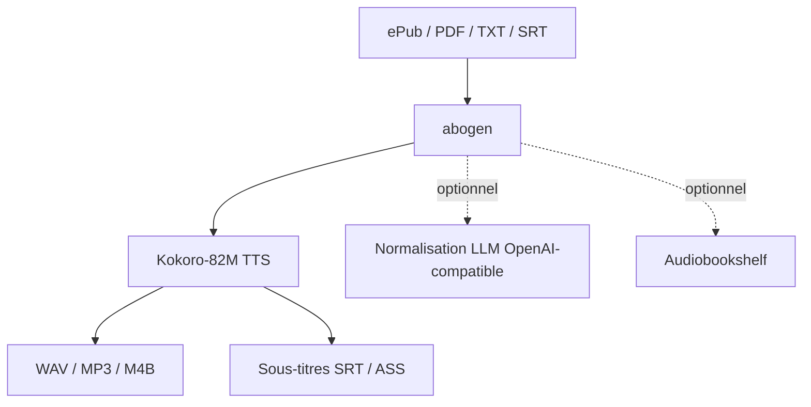

# denizsafak/abogen

> Text-to-speech tool that turns ePub/PDF/text/markdown/subtitles into audio with synchronized subtitles.

## The problem
Creating an audiobook or a voice-over from a document means assembling TTS, chapter splitting and subtitle synchronization by hand.

## What it actually does
Converts ePub, PDF, TXT, MD, SRT/ASS/VTT into audio (WAV/FLAC/MP3/OPUS/M4B with chapters) via Kokoro-82M, with synchronized subtitles (line, sentence, word, highlighting). Two interfaces: a PyQt6 GUI (`abogen`) and a Flask Web UI (`abogen-web`, with Supertonic TTS, LLM normalization, Audiobookshelf integration). Voice mixer, queue mode, chapter markers and metadata, timestamp splitting. Text normalization through an OpenAI-compatible LLM (Ollama…).

## How it is wired


## Trying it
```bash
uv tool install --python 3.12 abogen[cuda] --extra-index-url https://download.pytorch.org/whl/cu128 --index-strategy unsafe-best-match
```
```bash
abogen-web
```

## Cost and gotchas
Free. espeak-ng required. NVIDIA GPU (CUDA) recommended; AMD ROCm on Linux only, CPU possible but slow. Python 3.12/3.13 depending on platform. Web UI under active development (features ahead of the desktop one). LLM normalization = key/endpoint at your expense. Single maintainer.

## What it is not
Not arbitrary voice cloning: Kokoro voices (mixable). Not a hosted service: local or container.

## Alternatives
Not named in the README (Kokoro and Supertonic are the engines, not substitutes).

## For you
Useful for producing audiobooks/voice-overs locally with subtitles; the LLM/Ollama integration and chaptered M4B are pluses. Watch (single maintainer).
