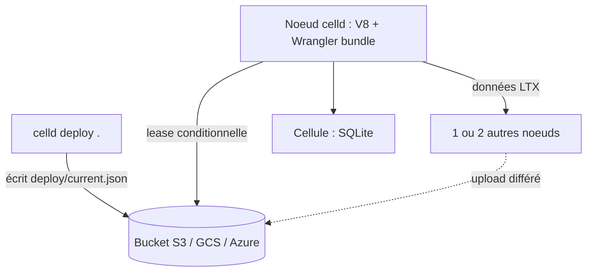

# denoland/celld

> Daemon that runs Cloudflare Workers and Durable Objects applications on your own machines, with S3 storage.

## The problem
Cloudflare's Durable Objects, KV, Queues and D1 lock the application into their network; running them at home requires rebuilding all of that.

## What it actually does
Each node embeds V8, runs Wrangler bundles and deploys from your `wrangler.json`. Each object is a cell with its own SQLite database, whose durable state lives in an S3, GCS or Azure Blob bucket. A conditional write on the bucket gives ownership of a cell; there is no consensus and no control plane.

## How it is wired


## Trying it
```bash
curl -fsSL https://celld.dev/install.sh | sh
celld dev
celld deploy . --bucket s3://my-cells-bucket
```

## Cost and gotchas
Apache 2.0 license. You need an S3, GCS or Azure compatible bucket, and `esbuild` in the `PATH` for Workers. A single node waits for the bucket on every write (about 90 ms in the local region, up to 600 ms measured elsewhere): plan for at least two nodes. The internal port must stay on a private network.

## What it is not
It is not Cloudflare: anything that requires their network, a GPU or a fleet of browsers is out of scope. Containers are experimental, and pull requests are disabled (patches by email).

## Alternatives
The README does not name any alternative.

## For you
Worth watching: interesting if you already host Workers and want durable state without Cloudflare, but outside your core data and AI work.
